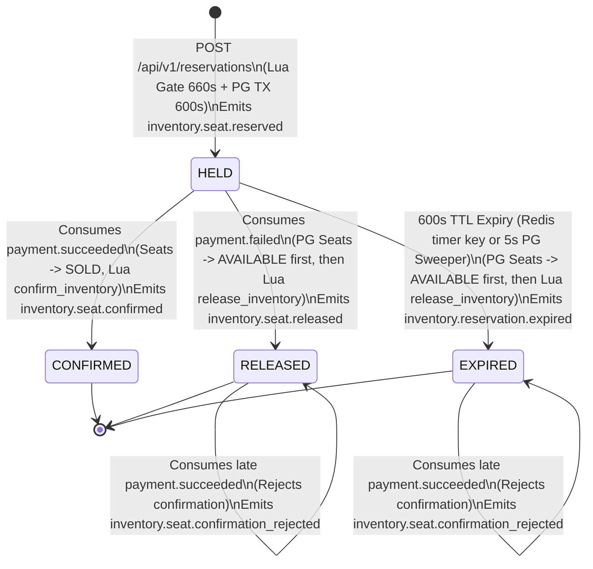
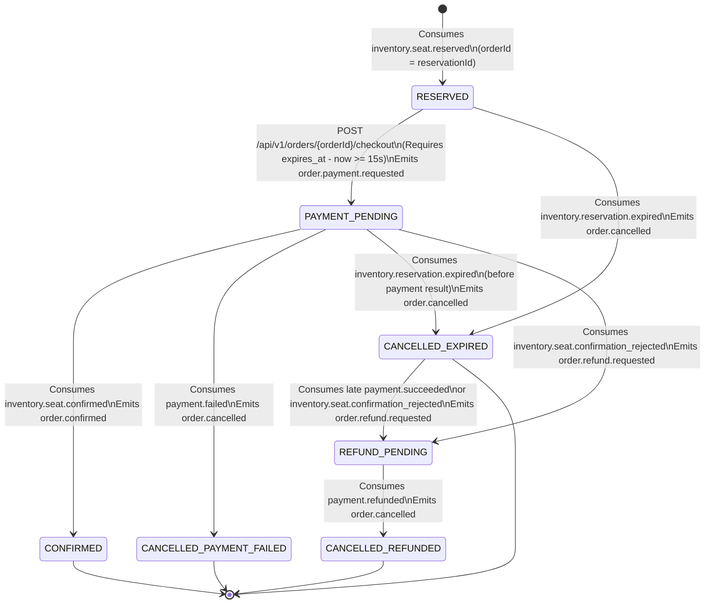

# Flash-Sale Ticketing Platform — Architecture Contract

This document is the authoritative engineering and implementation contract for the flash-sale ticketing platform. All engineers and AI coding agents must treat every port, database schema, SQL constraint, Redis key, Lua script, Kafka topic, JSON payload, HTTP endpoint, and configuration property in this document as the single source of truth.

---

## 1. Service Responsibilities

### 1.1 System Topology Overview

| Service Name | Runtime & Framework | HTTP Port | Database Instance | Stateful / Stateless |
| :--- | :--- | :--- | :--- | :--- |
| `gateway-service` | Java 21, Spring Boot 3.3.5, Spring Cloud Gateway (WebFlux / Project Reactor) | `8080` | None (uses Redis 7 for rate limiting) | Stateless |
| `inventory-service` | Java 21, Spring Boot 3.3.5, Spring MVC, Spring Data JDBC / JPA, Spring Kafka | `8081` | PostgreSQL 16 (`inventory_db`) + Redis 7 | Stateful |
| `order-service` | Java 21, Spring Boot 3.3.5, Spring MVC, Spring Data JDBC / JPA, Spring Kafka | `8082` | PostgreSQL 16 (`order_db`) | Stateful |
| `payment-service` | Java 21, Spring Boot 3.3.5, Spring MVC, Spring Data JDBC / JPA, Spring Kafka | `8083` | PostgreSQL 16 (`payment_db`) | Stateful |
| `notification-service` | Go 1.23, standard `net/http`, `segmentio/kafka-go`, `redis/go-redis/v9` | `8084` | None (uses Redis 7 for event deduplication) | Stateless |

```mermaid
graph LR
  Client[Client] -->|JWT + Idempotency-Key| GW[gateway-service :8080]
  GW -->|POST /api/v1/auth/token| GW
  GW -->|POST /api/v1/admin/events| Inv[inventory-service :8081]
  GW -->|POST /api/v1/reservations| Inv
  GW -->|POST /api/v1/orders/{orderId}/checkout| Ord[order-service :8082]
  GW -->|Rate Limit Lua| Redis[(Redis 7 :6379)]
  Inv -->|Lua Gate 660s Seat TTL + 600s Timer Key| Redis
  Inv -->|Sync TX + Outbox| InvDB[(inventory_db PG16)]
  Ord -->|Sync TX + Outbox| OrdDB[(order_db PG16)]
  Pay[payment-service :8083] -->|Sync TX + Outbox| PayDB[(payment_db PG16)]
  Inv -->|200ms FOR UPDATE SKIP LOCKED Poller| Kafka[(Apache Kafka KRaft :9092)]
  Ord -->|200ms FOR UPDATE SKIP LOCKED Poller| Kafka
  Pay -->|200ms FOR UPDATE SKIP LOCKED Poller| Kafka
  Kafka -->|inventory.events| Ord
  Kafka -->|order.events| Pay
  Kafka -->|payment.events| Inv
  Kafka -->|payment.events| Ord
  Kafka -->|order.events| Notif[notification-service :8084 Go Stateless]
  Notif -->|SET notif:dedup NX EX| Redis
```

---

### 1.2 Per-Service Ownership & Forbidden Actions

#### `gateway-service` (Port `8080`)
- **What It Owns**:
  - Edge HTTP routing to `inventory-service` (`:8081`) and `order-service` (`:8082`).
  - Development-only token issuance via `POST /api/v1/auth/token` (active only when `SPRING_PROFILES_ACTIVE` includes `dev` or `local`), minting HS256 JWTs signed with `JWT_SECRET` containing `sub` (UUID string) and `roles` (JSON string array).
  - Stateless HS256 Bearer JWT signature and expiration verification on all protected `/api/v1/**` routes.
  - Role-based access control (RBAC) enforcement for `/api/v1/admin/**` routes, requiring the `ADMIN` role in the verified JWT `roles` claim.
  - Propagation of verified identity headers (`X-User-Id` from `sub`, `X-User-Roles` from `roles`) and stripping of any client-supplied `X-User-Id` or `X-User-Roles` headers to prevent header spoofing.
  - Generation or propagation of `X-Correlation-Id` (UUIDv4) on every incoming HTTP request and response.
  - Per-user (for authenticated routes) and per-IP (for public routes) token-bucket rate limiting backed by Redis 7.
- **What It Must Never Do**:
  - Must never connect to `inventory_db`, `order_db`, or `payment_db`.
  - Must never produce to or consume from Apache Kafka.
  - Must never execute business state validation, seat availability checks, or price calculations.
  - Must never expose `/api/v1/auth/token` when running with `SPRING_PROFILES_ACTIVE=prod`.

#### `inventory-service` (Port `8081`)
- **What It Owns**:
  - System of record for events (`events`), discrete numbered seats (`seats`, scoped strictly to `ASSIGNED` inventory), seat reservations (`reservations`), and reserved seat line items (`reservation_items`) in `inventory_db`.
  - Admin endpoints (`POST /api/v1/admin/events` and `POST /api/v1/admin/events/{eventId}/seats/bulk`) restricted to callers with the `ADMIN` role.
  - Public seat map availability queries (`GET /api/v1/events/{eventId}/seats`) and customer seat reservation creation (`POST /api/v1/reservations`).
  - High-concurrency flash-sale gatekeeper in Redis 7 via atomic Lua scripts (`hold_inventory.lua`, `release_inventory.lua`, `confirm_inventory.lua`).
  - Authoritative hold expiration in PostgreSQL (`expires_at = created_at + INTERVAL '600 seconds'`), triggered either by Redis keyspace expiry notifications (`__keyevent@0__:expired` on `reservation:ttl:{reservationId}` with 600s TTL) or by the 5-second PostgreSQL fallback sweeper, always committing the PostgreSQL state change (`HELD -> EXPIRED`) before invoking `release_inventory.lua` in Redis (where seat lock keys `seat:{eventId}:{seatId}` carry a 660-second TTL).
  - Publishing `inventory.seat.reserved`, `inventory.seat.released`, `inventory.reservation.expired`, `inventory.seat.confirmed`, and `inventory.seat.confirmation_rejected` via its local `outbox_events` table and 200 ms `FOR UPDATE SKIP LOCKED` polling publisher to topic `inventory.events`.
- **What It Must Never Do**:
  - Must never create orders, calculate payment totals for billing, or call `payment-service` or `order-service` over synchronous HTTP.
  - Must never allow Redis to release a held seat (`seat:{eventId}:{seatId}`) before PostgreSQL has committed the transition of that reservation to `EXPIRED` or `RELEASED`.
  - Must never read from or write to `order_db` or `payment_db`.

#### `order-service` (Port `8082`)
- **What It Owns**:
  - System of record for customer orders (`orders`, where `order_id` is always identical to `reservation_id`) and order line items (`order_items`) in `order_db`.
  - Consuming `inventory.seat.reserved` from `inventory.events` to materialize orders in the `RESERVED` state with deterministic `order_id = reservation_id`.
  - Handling customer checkout requests (`POST /api/v1/orders/{orderId}/checkout`) and order status queries (`GET /api/v1/orders/{orderId}`).
  - Returning `409 Conflict` with error code `ORDER_NOT_READY` and HTTP header `Retry-After: 1` whenever a client calls `POST /api/v1/orders/{orderId}/checkout` before `inventory.seat.reserved` has been consumed and persisted in `order_db`.
  - Driving compensation when a late payment collides with an expired reservation by transitioning the order to `REFUND_PENDING` and emitting `order.refund.requested`.
  - Publishing `order.payment.requested`, `order.refund.requested`, `order.confirmed`, and `order.cancelled` via its local `outbox_events` table and 200 ms `FOR UPDATE SKIP LOCKED` polling publisher to topic `order.events`.
- **What It Must Never Do**:
  - Must never mutate seat inventory in Redis or `inventory_db`.
  - Must never call `inventory-service` or `payment-service` over synchronous HTTP; all cross-service coordination occurs exclusively via Kafka events.
  - Must never accept a checkout request if the order's `expires_at` is less than 15 seconds in the future (`expires_at - NOW() < INTERVAL '15 seconds'`).

#### `payment-service` (Port `8083`)
- **What It Owns**:
  - System of record for payment transactions and refunds (`payments`) in `payment_db`.
  - Consuming `order.payment.requested` and `order.refund.requested` from `order.events`.
  - Executing the configurable mock payment provider (supporting deterministic simulation via payment method tokens as well as configurable random latency and failure rate via environment variables).
  - Enforcing strict one-charge-per-order idempotency (`UNIQUE (order_id)` on charge records in `payments`).
  - Publishing `payment.succeeded`, `payment.failed`, and `payment.refunded` via its local `outbox_events` table and 200 ms `FOR UPDATE SKIP LOCKED` polling publisher to topic `payment.events`.
- **What It Must Never Do**:
  - Must never expose public customer-facing mutation endpoints through `gateway-service` (all payment executions are triggered asynchronously by `order.payment.requested` and `order.refund.requested`).
  - Must never directly access `order_db` or `inventory_db` or manipulate Redis seat locks.

#### `notification-service` (Port `8084`, Go)
- **What It Owns**:
  - Consuming terminal order lifecycle events (`order.confirmed` and `order.cancelled`) from `order.events`.
  - Stateless event deduplication using Redis 7 (`SET notif:dedup:{eventId} "1" NX EX 604800`).
  - Formatting and dispatching user notifications (structured JSON email/push simulation output and Prometheus metrics).
- **What It Must Never Do**:
  - Must never own or connect to any PostgreSQL database (`notification-service` is strictly stateless).
  - Must never publish domain events that participate in or block the order/inventory/payment saga.
  - Must never mutate Redis keys outside the `notif:dedup:*` namespace.

---

## 2. Order Saga (Choreography)

### 2.1 End-to-End Two-Step Flow (`orderId = reservationId`)

The platform uses a **two-step hold-then-pay choreography saga** partitioned across `inventory-service`, `order-service`, `payment-service`, and `notification-service`. To eliminate cross-service ID lookup round-trips and allow the client to proceed from Step 1 to Step 2 with a single identifier, **`orderId` is strictly equal to `reservationId`** (`order_id = reservation_id`) across all APIs, databases, and Kafka events.

1. **Step 1 — Seat Hold (`POST /api/v1/reservations` on `inventory-service`)**:
   - The client submits `eventId` and `seatIds` (1 to 6 assigned seat UUIDs) with an `Idempotency-Key` header.
   - `inventory-service` generates `reservationId` (UUIDv7) and executes `hold_inventory.lua` in Redis 7. The Lua script atomically checks that the event drop time has passed, verifies none of the `seat:{eventId}:{seatId}` keys exist, sets each `seat:{eventId}:{seatId}` to `reservationId` with a **660-second TTL** (`EX 660`), and sets a shadow timer key `reservation:ttl:{reservationId}` with a **600-second TTL** (`EX 600`).
   - `inventory-service` opens a local PostgreSQL transaction on `inventory_db`, updates `seats` (`status = 'HELD'`, `version = version + 1`), inserts `reservations` (`reservation_id`, `status = 'HELD'`, `expires_at = created_at + INTERVAL '600 seconds'`), inserts `reservation_items` (`status = 'HELD'`), and inserts an `inventory.seat.reserved` event into `outbox_events`.
   - If the PostgreSQL transaction throws any exception or rolls back, `inventory-service` immediately executes `release_inventory.lua` in a `finally` block to remove the Redis keys.
   - Upon PostgreSQL commit, `inventory-service` returns `201 Created` with `reservationId` (which is also the `orderId`) and `expiresAt`.
   - Within 200 ms, the `inventory-service` outbox poller publishes `inventory.seat.reserved` to `inventory.events` using `reservationId` as the Kafka partition key.
   - `order-service` consumes `inventory.seat.reserved` and inserts a row into `order_db.orders` with `order_id = reservationId`, `reservation_id = reservationId`, `status = 'RESERVED'`, and `expires_at`.
2. **Step 2 — Order Checkout (`POST /api/v1/orders/{orderId}/checkout` on `order-service`)**:
   - The client calls `POST /api/v1/orders/{orderId}/checkout` (where `orderId` equals `reservationId`) with `paymentMethodToken` and an `Idempotency-Key` header.
   - If the `orders` row for `orderId` has not yet been materialized from `inventory.seat.reserved`, `order-service` immediately returns `409 Conflict` with RFC 7807 error code `ORDER_NOT_READY` and header `Retry-After: 1`.
   - If the order exists in `RESERVED` state and `expires_at - NOW() >= INTERVAL '15 seconds'`, `order-service` updates `orders.status` to `PAYMENT_PENDING`, inserts `order.payment.requested` into `outbox_events`, and returns `202 Accepted`.

---

### 2.2 State Machines

#### `inventory-service` Reservation State Machine (`inventory_db.reservations.status`)



#### `order-service` Order Saga State Machine (`order_db.orders.status`)



---

### 2.3 Exhaustive State Transition Table

#### Table A: `inventory-service` Transitions (`inventory_db.reservations`)

| Current State | Triggering HTTP Call or Kafka Event | Guard Condition | Database Mutation (`inventory_db`) | Post-Commit Redis Action | Outbox Event Emitted (`inventory.events`) | Next State |
| :--- | :--- | :--- | :--- | :--- | :--- | :--- |
| `(None)` | `POST /api/v1/reservations` | Pre-TX `hold_inventory.lua` returned `OK`; `seats.status = 'AVAILABLE'` in PG | Insert `reservations` (`HELD`, `expires_at = now + 600s`), insert `reservation_items` (`HELD`), update `seats` (`status = 'HELD'`, `version + 1`) | Already set in pre-TX Lua (`seat:{eventId}:{seatId}` EX 660, `reservation:ttl:{reservationId}` EX 600); if PG TX fails, run `release_inventory.lua` | `inventory.seat.reserved` | `HELD` |
| `HELD` | `payment.succeeded` | `reservations.status = 'HELD'` (even if `now > expires_at`, as long as expiry handler has not committed `EXPIRED`) | Update `reservations` (`CONFIRMED`, `confirmed_at = now`), update `reservation_items` (`CONFIRMED`), update `seats` (`status = 'SOLD'`, `version + 1`) | Execute `confirm_inventory.lua` (sets `seat:{eventId}:{seatId}` to `"SOLD"` EX 86400 and deletes `reservation:ttl:{reservationId}`) | `inventory.seat.confirmed` | `CONFIRMED` |
| `HELD` | `payment.failed` | `reservations.status = 'HELD'` | Update `reservations` (`RELEASED`), update `reservation_items` (`RELEASED`), update `seats` (`status = 'AVAILABLE'`, `version + 1`) | Execute `release_inventory.lua` (deletes `seat:{eventId}:{seatId}` matching `reservationId` and deletes `reservation:ttl:{reservationId}`) | `inventory.seat.released` | `RELEASED` |
| `HELD` | Redis `__keyevent@0__:expired` on `reservation:ttl:{reservationId}` OR 5s PG Sweeper | `reservations.status = 'HELD' AND expires_at <= NOW()` | Update `reservations` (`EXPIRED`), update `reservation_items` (`EXPIRED`), update `seats` (`status = 'AVAILABLE'`, `version + 1`) | Execute `release_inventory.lua` **after** PG TX commit (deletes `seat:{eventId}:{seatId}` matching `reservationId`) | `inventory.reservation.expired` | `EXPIRED` |
| `EXPIRED` or `RELEASED` | `payment.succeeded` | `reservations.status IN ('EXPIRED', 'RELEASED')` | No change to `reservations` or `seats`; record `processed_events` | None | `inventory.seat.confirmation_rejected` | `EXPIRED` or `RELEASED` |
| `CONFIRMED` | Expiry timer or duplicate `payment.succeeded` | `reservations.status = 'CONFIRMED'` | No-op (idempotent ignore) | None | None | `CONFIRMED` |

#### Table B: `order-service` Transitions (`order_db.orders`)

| Current State | Triggering HTTP Call or Kafka Event | Guard Condition | Database Mutation (`order_db`) | Outbox Event Emitted (`order.events`) | Next State |
| :--- | :--- | :--- | :--- | :--- | :--- |
| `(None)` | `inventory.seat.reserved` | `order_id` does not exist in `orders` | Insert `orders` (`order_id = reservation_id`, `status = 'RESERVED'`, `expires_at`) and `order_items` | None | `RESERVED` |
| `(None)` | `POST /api/v1/orders/{orderId}/checkout` | `order_id` not found in `orders` | None (reject HTTP request with `409 ORDER_NOT_READY` and `Retry-After: 1` header) | None | `(None)` |
| `RESERVED` | `POST /api/v1/orders/{orderId}/checkout` | `expires_at - NOW() >= INTERVAL '15 seconds'` | Update `orders` (`status = 'PAYMENT_PENDING'`, `payment_method_token`, `checkout_at = now`) | `order.payment.requested` | `PAYMENT_PENDING` |
| `RESERVED` | `POST /api/v1/orders/{orderId}/checkout` | `expires_at - NOW() < INTERVAL '15 seconds'` | None (reject HTTP request with `409 RESERVATION_EXPIRED`) | None | `RESERVED` |
| `RESERVED` | `inventory.reservation.expired` | `orders.status = 'RESERVED'` | Update `orders` (`status = 'CANCELLED_EXPIRED'`, `cancelled_at = now`, `cancellation_reason = 'RESERVATION_EXPIRED'`) | `order.cancelled` | `CANCELLED_EXPIRED` |
| `PAYMENT_PENDING` | `payment.succeeded` | `orders.status = 'PAYMENT_PENDING'` | Update `orders` (`payment_id = payload.paymentId`, `paid_at = payload.paidAt`); remain in `PAYMENT_PENDING` awaiting `inventory.seat.confirmed` or `inventory.seat.confirmation_rejected` | None | `PAYMENT_PENDING` |
| `PAYMENT_PENDING` | `inventory.seat.confirmed` | `orders.status = 'PAYMENT_PENDING'` | Update `orders` (`status = 'CONFIRMED'`, `confirmed_at = now`) | `order.confirmed` | `CONFIRMED` |
| `PAYMENT_PENDING` | `payment.failed` | `orders.status = 'PAYMENT_PENDING'` | Update `orders` (`status = 'CANCELLED_PAYMENT_FAILED'`, `cancelled_at = now`, `cancellation_reason = 'PAYMENT_FAILED'`) | `order.cancelled` | `CANCELLED_PAYMENT_FAILED` |
| `PAYMENT_PENDING` | `inventory.reservation.expired` | `orders.status = 'PAYMENT_PENDING'` and `payment_id IS NULL` | Update `orders` (`status = 'CANCELLED_EXPIRED'`, `cancelled_at = now`, `cancellation_reason = 'RESERVATION_EXPIRED'`) | `order.cancelled` | `CANCELLED_EXPIRED` |
| `PAYMENT_PENDING` | `inventory.seat.confirmation_rejected` | `orders.status = 'PAYMENT_PENDING'` | Update `orders` (`status = 'REFUND_PENDING'`, `payment_id = payload.paymentId`, `cancellation_reason = 'LATE_PAYMENT_EXPIRED_HOLD'`) | `order.refund.requested` | `REFUND_PENDING` |
| `CANCELLED_EXPIRED` | `payment.succeeded` OR `inventory.seat.confirmation_rejected` | `orders.status = 'CANCELLED_EXPIRED'` | Update `orders` (`status = 'REFUND_PENDING'`, `payment_id = payload.paymentId`, `cancellation_reason = 'LATE_PAYMENT_EXPIRED_HOLD'`) | `order.refund.requested` | `REFUND_PENDING` |
| `REFUND_PENDING` | `payment.refunded` | `orders.status = 'REFUND_PENDING'` | Update `orders` (`status = 'CANCELLED_REFUNDED'`, `refunded_at = now`) | `order.cancelled` | `CANCELLED_REFUNDED` |

---

### 2.4 Edge Cases, Race Conditions, and Failure Recovery

#### 1. Checkout Before `inventory.seat.reserved` Is Consumed (Early-Checkout Race)
- **Scenario**: The client receives `201 Created` from `POST /api/v1/reservations` on `inventory-service` at `t = 0 ms` and immediately calls `POST /api/v1/orders/{orderId}/checkout` at `t = 15 ms`, before the `inventory-service` 200 ms outbox poller and `order-service` consumer have materialized the `orders` row in `order_db`.
- **Mandatory Resolution**: `order-service` queries `SELECT status, expires_at FROM orders WHERE order_id = :orderId`. When zero rows are returned, `order-service` does **not** return `404 Not Found` and does **not** block threads waiting on Kafka. It returns HTTP `409 Conflict` with header `Retry-After: 1` and RFC 7807 error code `ORDER_NOT_READY`. Because `Idempotency-Key` is only committed for `RESERVED -> PAYMENT_PENDING` transitions (or released on `409 ORDER_NOT_READY`), the client retries `/api/v1/orders/{orderId}/checkout` after 1 second with the same `Idempotency-Key`.

#### 2. Late Payment vs. Reservation TTL Expiry Race (`payment.succeeded` vs. `inventory.reservation.expired`)
- **Scenario**: A user initiates checkout at `t = 580s`. `payment-service` experiences provider latency and completes the charge at `t = 601s`, emitting `payment.succeeded`. Meanwhile, at `t = 600s`, `inventory-service` expired the hold in `inventory_db` (`HELD -> EXPIRED`), released the seat to another buyer, and emitted `inventory.reservation.expired`.
- **Mandatory Resolution**:
  1. **Grace Buffer at Checkout**: `order-service` rejects any `POST /api/v1/orders/{orderId}/checkout` request where `expires_at - NOW() < INTERVAL '15 seconds'` with `409 Conflict` (`RESERVATION_EXPIRED`).
  2. **Authoritative Inventory Check**: `order-service` never transitions directly from `PAYMENT_PENDING` to `CONFIRMED` solely upon receiving `payment.succeeded`. Instead, `inventory-service` consumes `payment.succeeded` and checks `reservations.status` in `inventory_db` under `FOR UPDATE` row lock:
     - If `reservations.status == 'HELD'`, `inventory-service` transitions the reservation to `CONFIRMED`, marks seats `SOLD`, and emits `inventory.seat.confirmed`.
     - If `reservations.status IN ('EXPIRED', 'RELEASED')`, `inventory-service` leaves the reservation untouched and emits `inventory.seat.confirmation_rejected` with `paymentId` and `reason = 'RESERVATION_ALREADY_EXPIRED'`.
  3. **Automatic Refund Compensation**: When `order-service` consumes `inventory.seat.confirmation_rejected` (or consumes `payment.succeeded` after already transitioning to `CANCELLED_EXPIRED`), it transitions the order to `REFUND_PENDING` and emits `order.refund.requested`. `payment-service` consumes `order.refund.requested`, refunds the charge, and emits `payment.refunded`, transitioning the order to `CANCELLED_REFUNDED`. Zero seats are oversold, and zero customers are charged for unfulfilled tickets.

#### 3. Duplicate Kafka Events (At-Least-Once Delivery)
- **Scenario**: An outbox poller crashes after sending a Kafka batch but before committing `UPDATE outbox_events SET published_at = NOW()`, or a Kafka consumer rebalances mid-batch, causing duplicate delivery of `inventory.seat.reserved`, `order.payment.requested`, or `payment.succeeded`.
- **Mandatory Resolution**:
  - Every stateful consumer (`inventory-service`, `order-service`, `payment-service`) executes `INSERT INTO processed_events (event_id, consumer_group, processed_at) VALUES (:eventId, :groupId, NOW()) ON CONFLICT (event_id, consumer_group) DO NOTHING` inside the same local PostgreSQL transaction as its domain table updates. If `0` rows are inserted, the consumer logs at `DEBUG` level and acknowledges the offset immediately without mutating state.
  - Even if two different `eventId` instances represent the same logical transition (for example, both the Redis keyspace listener and the 5s PostgreSQL sweeper attempting to expire the same reservation concurrently), the `FOR UPDATE` row lock on `reservations` checks `WHERE status = 'HELD'`, so only the first transaction succeeds and emits `inventory.reservation.expired`.

#### 4. Service Crashing Mid-Saga
- **Crash in `inventory-service` after Redis `hold_inventory.lua` succeeds but before PostgreSQL commit**:
  - The PostgreSQL transaction never commits, so no `reservations` row exists in `inventory_db` and no `inventory.seat.reserved` event is emitted. In the rare case the JVM is `SIGKILL`-ed before the `finally` block can invoke `release_inventory.lua`, the Redis key `seat:{eventId}:{seatId}` automatically expires after its 660-second TTL, self-healing the seat lock.
- **Crash in `inventory-service`, `order-service`, or `payment-service` after PostgreSQL commit but before Outbox Poller publishes to Kafka**:
  - Because `outbox_events` was committed atomically in the same local PostgreSQL transaction as the domain state change (`published_at IS NULL`), the next 200 ms poll cycle on any live replica picks up the row via `FOR UPDATE SKIP LOCKED` and publishes it to Kafka.
- **Crash in `payment-service` during external mock provider execution**:
  - When `order.payment.requested` is redelivered after consumer rebalance or retry backoff, `payment-service` checks `payments` by `UNIQUE (order_id)`. If a row already exists in `SUCCEEDED` or `FAILED` status, it does not double-charge.

---

## 3. Kafka Design

### 3.1 Broker & Cluster Configuration (KRaft Mode)
- **Kafka Version**: Apache Kafka `3.8.0` running in **KRaft mode** (`process.roles=broker,controller`, zero ZooKeeper dependency).
- **Producer Settings (All Java Outbox Pollers)**:
  - `acks=all`
  - `enable.idempotence=true`
  - `max.in.flight.requests.per.connection=5`
  - `retries=2147483647`
  - `compression.type=lz4`
  - `linger.ms=5`
- **Consumer Settings (Java & Go Services)**:
  - `enable.auto.commit=false` (manual offset acknowledgment only after local DB transaction commits or Redis deduplication succeeds)
  - `isolation.level=read_committed`
  - `auto.offset.reset=earliest`
  - `max.poll.records=100`

---

### 3.2 Primary Domain Topics Table

All domain events belonging to a reservation/order lifecycle use `reservationId` (which equals `orderId`) as the Kafka message key (`StringSerializer` of the UUID string). This guarantees that all events for a single reservation/order land on the exact same partition and are processed in causal order per consumer group.

| Topic Name | Partitions (Docker Compose) | Partitions (Kubernetes) | Replication Factor (Compose / K8s) | `min.insync.replicas` (Compose / K8s) | Partition Key | Retention (`retention.ms`) | Cleanup Policy | Producer Service | Consumer Services (`group.id`) |
| :--- | :--- | :--- | :--- | :--- | :--- | :--- | :--- | :--- | :--- |
| `inventory.events` | `12` | `24` | `1` / `3` | `1` / `2` | `reservationId` (`orderId`) | `604800000` (7 days) | `delete` | `inventory-service` | `order-service` (`order-service-inventory-cg`) |
| `order.events` | `12` | `24` | `1` / `3` | `1` / `2` | `orderId` (`reservationId`) | `604800000` (7 days) | `delete` | `order-service` | `payment-service` (`payment-service-order-cg`), `notification-service` (`notification-service-order-cg`) |
| `payment.events` | `12` | `24` | `1` / `3` | `1` / `2` | `orderId` (`reservationId`) | `604800000` (7 days) | `delete` | `payment-service` | `inventory-service` (`inventory-service-payment-cg`), `order-service` (`order-service-payment-cg`) |

---

### 3.3 Retry Topics and Dead-Letter Topic (DLT) Convention

Every consumer group is isolated with **2 retry topic levels (`2s` and `10s` backoff)** plus **1 dead-letter topic (DLT)** using the Spring Kafka `@RetryableTopic` naming convention (`RetryTopicNamesProviderFactory` with consumer group qualifier):

- **Retry Level 1 (2,000 ms delay)**: `<topic>-<consumer-group>-retry-0`
- **Retry Level 2 (10,000 ms delay)**: `<topic>-<consumer-group>-retry-1`
- **Dead-Letter Topic**: `<topic>-<consumer-group>-dlt`

#### Spring Kafka `@RetryableTopic` Configuration Contract
- `attempts = "3"` (1 initial attempt on main topic + 2 retry attempts on `-retry-0` and `-retry-1`)
- `backoff = @Backoff(delay = 2000, multiplier = 5.0)` (produces exact delays of `2000 ms` for `-retry-0` and `10000 ms` for `-retry-1`)
- `autoCreateTopics = "false"` (all main, retry, and DLT topics are provisioned deterministically at startup via `kafka-topics.sh` / Strimzi `KafkaTopic` manifests)
- `dltStrategy = DltStrategy.FAIL_ON_ERROR`
- Non-retryable exceptions (`JsonProcessingException`, `IllegalArgumentException`, schema validation failures) bypass `-retry-0` and `-retry-1` and route directly to `-dlt`.
- The Go `notification-service` implements the exact same topic topology and naming pattern (`order.events-notification-service-order-cg-retry-0`, `order.events-notification-service-order-cg-retry-1`, `order.events-notification-service-order-cg-dlt`) by inspecting the `retry_attempt` and `retry_timestamp_ms` Kafka headers before forwarding failed messages.

#### Complete Retry & Dead-Letter Topics Table

| Topic Name | Backoff Delay | Partitions (Compose / K8s) | Replication Factor (Compose / K8s) | Partition Key | Retention (`retention.ms`) | Producer / Forwarder | Consumer Group |
| :--- | :--- | :--- | :--- | :--- | :--- | :--- | :--- |
| `inventory.events-order-service-inventory-cg-retry-0` | `2000 ms` (2s) | `12` / `24` | `1` / `3` | `reservationId` | `604800000` (7d) | `order-service` | `order-service-inventory-cg-retry-0` |
| `inventory.events-order-service-inventory-cg-retry-1` | `10000 ms` (10s) | `12` / `24` | `1` / `3` | `reservationId` | `604800000` (7d) | `order-service` | `order-service-inventory-cg-retry-1` |
| `inventory.events-order-service-inventory-cg-dlt` | None (Terminal) | `3` / `6` | `1` / `3` | `reservationId` | `2592000000` (30d) | `order-service` | `order-service-inventory-cg-dlt` |
| `order.events-payment-service-order-cg-retry-0` | `2000 ms` (2s) | `12` / `24` | `1` / `3` | `orderId` | `604800000` (7d) | `payment-service` | `payment-service-order-cg-retry-0` |
| `order.events-payment-service-order-cg-retry-1` | `10000 ms` (10s) | `12` / `24` | `1` / `3` | `orderId` | `604800000` (7d) | `payment-service` | `payment-service-order-cg-retry-1` |
| `order.events-payment-service-order-cg-dlt` | None (Terminal) | `3` / `6` | `1` / `3` | `orderId` | `2592000000` (30d) | `payment-service` | `payment-service-order-cg-dlt` |
| `order.events-notification-service-order-cg-retry-0` | `2000 ms` (2s) | `12` / `24` | `1` / `3` | `orderId` | `604800000` (7d) | `notification-service` | `notification-service-order-cg-retry-0` |
| `order.events-notification-service-order-cg-retry-1` | `10000 ms` (10s) | `12` / `24` | `1` / `3` | `orderId` | `604800000` (7d) | `notification-service` | `notification-service-order-cg-retry-1` |
| `order.events-notification-service-order-cg-dlt` | None (Terminal) | `3` / `6` | `1` / `3` | `orderId` | `2592000000` (30d) | `notification-service` | `notification-service-order-cg-dlt` |
| `payment.events-inventory-service-payment-cg-retry-0` | `2000 ms` (2s) | `12` / `24` | `1` / `3` | `orderId` | `604800000` (7d) | `inventory-service` | `inventory-service-payment-cg-retry-0` |
| `payment.events-inventory-service-payment-cg-retry-1` | `10000 ms` (10s) | `12` / `24` | `1` / `3` | `orderId` | `604800000` (7d) | `inventory-service` | `inventory-service-payment-cg-retry-1` |
| `payment.events-inventory-service-payment-cg-dlt` | None (Terminal) | `3` / `6` | `1` / `3` | `orderId` | `2592000000` (30d) | `inventory-service` | `inventory-service-payment-cg-dlt` |
| `payment.events-order-service-payment-cg-retry-0` | `2000 ms` (2s) | `12` / `24` | `1` / `3` | `orderId` | `604800000` (7d) | `order-service` | `order-service-payment-cg-retry-0` |
| `payment.events-order-service-payment-cg-retry-1` | `10000 ms` (10s) | `12` / `24` | `1` / `3` | `orderId` | `604800000` (7d) | `order-service` | `order-service-payment-cg-retry-1` |
| `payment.events-order-service-payment-cg-dlt` | None (Terminal) | `3` / `6` | `1` / `3` | `orderId` | `2592000000` (30d) | `order-service` | `order-service-payment-cg-dlt` |

---

## 4. Event Contracts

### 4.1 Common Event Envelope
Every Kafka record value across `inventory.events`, `order.events`, and `payment.events` is serialized as UTF-8 JSON conforming to this top-level envelope:

| Field | JSON Type | Format / Constraints | Description |
| :--- | :--- | :--- | :--- |
| `eventId` | `string` | UUIDv7 (`36` chars) | Globally unique identifier for this event instance (used as primary key in `outbox_events` and `processed_events`). |
| `eventType` | `string` | Lowercase dot-separated | Exact event type discriminator (`inventory.seat.reserved`, `order.payment.requested`, and so on). |
| `occurredAt` | `string` | ISO-8601 UTC (`YYYY-MM-DDTHH:mm:ss.SSSSSSZ`) | Timestamp when the event was created inside the producer's database transaction. |
| `correlationId` | `string` | UUID (`36` chars) | End-to-end trace correlation ID propagated from the originating HTTP `X-Correlation-Id` header or background job. |
| `schemaVersion` | `integer` | Positive integer (`1`) | Version of the `payload` schema for forward/backward compatibility. |
| `payload` | `object` | Non-null JSON object | Event-specific payload defined in Section 4.2. |

#### Canonical Envelope Example
```json
{
  "eventId": "01926b54-7c8a-7000-8000-1a2b3c4d5e6f",
  "eventType": "inventory.seat.reserved",
  "occurredAt": "2026-10-27T22:00:00.123456Z",
  "correlationId": "c9b1d8e0-2f4a-4b6c-9d1e-3f5a7b9c0d2e",
  "schemaVersion": 1,
  "payload": {}
}
```

#### Mandatory Kafka Record Headers
Every published Kafka message must include these UTF-8 string headers alongside the JSON body:
- `X-Correlation-Id`: Matches `correlationId` in the envelope.
- `event-type`: Matches `eventType` in the envelope (enables fast filtering by consumers without parsing the JSON body when ignoring unrelated events on shared topics).
- `event-id`: Matches `eventId` in the envelope.
- `schema-version`: `"1"`.

---

### 4.2 Event Payload Specifications (All 12 Events)

All monetary amounts in event payloads are represented in **integer minor currency units (`priceCents` / `totalAmountCents` as `integer` / `int64`)** along with a 3-letter ISO-4217 `currency` string (`"USD"`) to prevent floating-point rounding errors. All inventory items represent discrete **`ASSIGNED`** seats.

---

#### 4.2.1 `inventory.seat.reserved`
- **Topic**: `inventory.events` | **Partition Key**: `reservationId` | **Producer**: `inventory-service` | **Consumer**: `order-service`
- **Payload Fields**:
  - `reservationId` (`string`, UUID): Unique reservation identifier (used by `order-service` as `orderId`).
  - `orderId` (`string`, UUID): Identical to `reservationId`.
  - `userId` (`string`, UUID): Authenticated user who acquired the hold.
  - `eventId` (`string`, UUID): Target event identifier.
  - `seats` (`array` of `object`, min 1, max 6):
    - `seatId` (`string`, UUID): Seat primary key.
    - `sectionCode` (`string`): Venue section code (`"SEC-A"`).
    - `rowLabel` (`string`): Row identifier (`"12"`).
    - `seatNumber` (`string`): Seat number within the row (`"14"`).
    - `priceCents` (`integer`, int64): Price of this seat in minor units (`15000`).
  - `totalAmountCents` (`integer`, int64): Sum of `priceCents` across all reserved seats (`30000`).
  - `currency` (`string`, ISO-4217): `"USD"`.
  - `reservedAt` (`string`, ISO-8601 UTC): Hold creation timestamp.
  - `expiresAt` (`string`, ISO-8601 UTC): Authoritative PostgreSQL hold expiration timestamp (`reservedAt + 600s`).

```json
{
  "reservationId": "01926b54-1111-7000-8000-000000000001",
  "orderId": "01926b54-1111-7000-8000-000000000001",
  "userId": "a1b2c3d4-e5f6-4a5b-8c9d-0e1f2a3b4c5d",
  "eventId": "f0e1d2c3-b4a5-4968-8796-a5b4c3d2e1f0",
  "seats": [
    {
      "seatId": "11111111-2222-4333-8444-555555555501",
      "sectionCode": "FLOOR-A",
      "rowLabel": "1",
      "seatNumber": "101",
      "priceCents": 15000
    },
    {
      "seatId": "11111111-2222-4333-8444-555555555502",
      "sectionCode": "FLOOR-A",
      "rowLabel": "1",
      "seatNumber": "102",
      "priceCents": 15000
    }
  ],
  "totalAmountCents": 30000,
  "currency": "USD",
  "reservedAt": "2026-10-27T22:00:00.000000Z",
  "expiresAt": "2026-10-27T22:10:00.000000Z"
}
```

---

#### 4.2.2 `inventory.seat.released`
- **Topic**: `inventory.events` | **Partition Key**: `reservationId` | **Producer**: `inventory-service` | **Consumer**: `order-service`
- **Payload Fields**:
  - `reservationId` (`string`, UUID)
  - `orderId` (`string`, UUID): Identical to `reservationId`.
  - `eventId` (`string`, UUID)
  - `seatIds` (`array` of `string` UUIDs)
  - `reason` (`string`, enum: `"PAYMENT_FAILED"`)
  - `releasedAt` (`string`, ISO-8601 UTC)

```json
{
  "reservationId": "01926b54-1111-7000-8000-000000000001",
  "orderId": "01926b54-1111-7000-8000-000000000001",
  "eventId": "f0e1d2c3-b4a5-4968-8796-a5b4c3d2e1f0",
  "seatIds": [
    "11111111-2222-4333-8444-555555555501",
    "11111111-2222-4333-8444-555555555502"
  ],
  "reason": "PAYMENT_FAILED",
  "releasedAt": "2026-10-27T22:01:15.200000Z"
}
```

---

#### 4.2.3 `inventory.reservation.expired`
- **Topic**: `inventory.events` | **Partition Key**: `reservationId` | **Producer**: `inventory-service` | **Consumer**: `order-service`
- **Payload Fields**:
  - `reservationId` (`string`, UUID)
  - `orderId` (`string`, UUID): Identical to `reservationId`.
  - `userId` (`string`, UUID)
  - `eventId` (`string`, UUID)
  - `seatIds` (`array` of `string` UUIDs)
  - `expiredAt` (`string`, ISO-8601 UTC)

```json
{
  "reservationId": "01926b54-1111-7000-8000-000000000001",
  "orderId": "01926b54-1111-7000-8000-000000000001",
  "userId": "a1b2c3d4-e5f6-4a5b-8c9d-0e1f2a3b4c5d",
  "eventId": "f0e1d2c3-b4a5-4968-8796-a5b4c3d2e1f0",
  "seatIds": [
    "11111111-2222-4333-8444-555555555501",
    "11111111-2222-4333-8444-555555555502"
  ],
  "expiredAt": "2026-10-27T22:10:00.050000Z"
}
```

---

#### 4.2.4 `inventory.seat.confirmed`
- **Topic**: `inventory.events` | **Partition Key**: `reservationId` | **Producer**: `inventory-service` | **Consumer**: `order-service`
- **Payload Fields**:
  - `reservationId` (`string`, UUID)
  - `orderId` (`string`, UUID): Identical to `reservationId`.
  - `paymentId` (`string`, UUID)
  - `eventId` (`string`, UUID)
  - `seatIds` (`array` of `string` UUIDs)
  - `confirmedAt` (`string`, ISO-8601 UTC)

```json
{
  "reservationId": "01926b54-1111-7000-8000-000000000001",
  "orderId": "01926b54-1111-7000-8000-000000000001",
  "paymentId": "01926b55-9999-7000-8000-000000000099",
  "eventId": "f0e1d2c3-b4a5-4968-8796-a5b4c3d2e1f0",
  "seatIds": [
    "11111111-2222-4333-8444-555555555501",
    "11111111-2222-4333-8444-555555555502"
  ],
  "confirmedAt": "2026-10-27T22:01:05.450000Z"
}
```

---

#### 4.2.5 `inventory.seat.confirmation_rejected`
- **Topic**: `inventory.events` | **Partition Key**: `reservationId` | **Producer**: `inventory-service` | **Consumer**: `order-service`
- **Payload Fields**:
  - `reservationId` (`string`, UUID)
  - `orderId` (`string`, UUID): Identical to `reservationId`.
  - `paymentId` (`string`, UUID)
  - `userId` (`string`, UUID)
  - `eventId` (`string`, UUID)
  - `reason` (`string`, enum: `"RESERVATION_ALREADY_EXPIRED"` | `"RESERVATION_ALREADY_RELEASED"`)
  - `rejectedAt` (`string`, ISO-8601 UTC)

```json
{
  "reservationId": "01926b54-1111-7000-8000-000000000001",
  "orderId": "01926b54-1111-7000-8000-000000000001",
  "paymentId": "01926b55-9999-7000-8000-000000000099",
  "userId": "a1b2c3d4-e5f6-4a5b-8c9d-0e1f2a3b4c5d",
  "eventId": "f0e1d2c3-b4a5-4968-8796-a5b4c3d2e1f0",
  "reason": "RESERVATION_ALREADY_EXPIRED",
  "rejectedAt": "2026-10-27T22:10:01.300000Z"
}
```

---

#### 4.2.6 `order.payment.requested`
- **Topic**: `order.events` | **Partition Key**: `orderId` | **Producer**: `order-service` | **Consumer**: `payment-service` (`notification-service` ignores via `event-type` header)
- **Payload Fields**:
  - `orderId` (`string`, UUID): Identical to `reservationId`.
  - `reservationId` (`string`, UUID): Identical to `orderId`.
  - `userId` (`string`, UUID)
  - `eventId` (`string`, UUID)
  - `amountCents` (`integer`, int64)
  - `currency` (`string`, ISO-4217): `"USD"`
  - `paymentMethodToken` (`string`): Token representing the payment instrument (`"pm_tok_visa_success"`, `"pm_tok_declined"`, `"pm_tok_timeout"`).
  - `requestedAt` (`string`, ISO-8601 UTC)
  - `reservationExpiresAt` (`string`, ISO-8601 UTC)

```json
{
  "orderId": "01926b54-1111-7000-8000-000000000001",
  "reservationId": "01926b54-1111-7000-8000-000000000001",
  "userId": "a1b2c3d4-e5f6-4a5b-8c9d-0e1f2a3b4c5d",
  "eventId": "f0e1d2c3-b4a5-4968-8796-a5b4c3d2e1f0",
  "amountCents": 30000,
  "currency": "USD",
  "paymentMethodToken": "pm_tok_visa_success",
  "requestedAt": "2026-10-27T22:01:02.000000Z",
  "reservationExpiresAt": "2026-10-27T22:10:00.000000Z"
}
```

---

#### 4.2.7 `order.refund.requested`
- **Topic**: `order.events` | **Partition Key**: `orderId` | **Producer**: `order-service` | **Consumer**: `payment-service`
- **Payload Fields**:
  - `orderId` (`string`, UUID)
  - `reservationId` (`string`, UUID)
  - `paymentId` (`string`, UUID)
  - `userId` (`string`, UUID)
  - `amountCents` (`integer`, int64)
  - `currency` (`string`, ISO-4217): `"USD"`
  - `reason` (`string`, enum: `"LATE_PAYMENT_EXPIRED_HOLD"`)
  - `requestedAt` (`string`, ISO-8601 UTC)

```json
{
  "orderId": "01926b54-1111-7000-8000-000000000001",
  "reservationId": "01926b54-1111-7000-8000-000000000001",
  "paymentId": "01926b55-9999-7000-8000-000000000099",
  "userId": "a1b2c3d4-e5f6-4a5b-8c9d-0e1f2a3b4c5d",
  "amountCents": 30000,
  "currency": "USD",
  "reason": "LATE_PAYMENT_EXPIRED_HOLD",
  "requestedAt": "2026-10-27T22:10:01.500000Z"
}
```

---

#### 4.2.8 `order.confirmed`
- **Topic**: `order.events` | **Partition Key**: `orderId` | **Producer**: `order-service` | **Consumer**: `notification-service`
- **Payload Fields**:
  - `orderId` (`string`, UUID)
  - `reservationId` (`string`, UUID)
  - `userId` (`string`, UUID)
  - `eventId` (`string`, UUID)
  - `paymentId` (`string`, UUID)
  - `seats` (`array` of `object` with `seatId`, `sectionCode`, `rowLabel`, `seatNumber`, `priceCents`)
  - `totalAmountCents` (`integer`, int64)
  - `currency` (`string`, ISO-4217): `"USD"`
  - `confirmedAt` (`string`, ISO-8601 UTC)

```json
{
  "orderId": "01926b54-1111-7000-8000-000000000001",
  "reservationId": "01926b54-1111-7000-8000-000000000001",
  "userId": "a1b2c3d4-e5f6-4a5b-8c9d-0e1f2a3b4c5d",
  "eventId": "f0e1d2c3-b4a5-4968-8796-a5b4c3d2e1f0",
  "paymentId": "01926b55-9999-7000-8000-000000000099",
  "seats": [
    {
      "seatId": "11111111-2222-4333-8444-555555555501",
      "sectionCode": "FLOOR-A",
      "rowLabel": "1",
      "seatNumber": "101",
      "priceCents": 15000
    },
    {
      "seatId": "11111111-2222-4333-8444-555555555502",
      "sectionCode": "FLOOR-A",
      "rowLabel": "1",
      "seatNumber": "102",
      "priceCents": 15000
    }
  ],
  "totalAmountCents": 30000,
  "currency": "USD",
  "confirmedAt": "2026-10-27T22:01:05.650000Z"
}
```

---

#### 4.2.9 `order.cancelled`
- **Topic**: `order.events` | **Partition Key**: `orderId` | **Producer**: `order-service` | **Consumer**: `notification-service`
- **Payload Fields**:
  - `orderId` (`string`, UUID)
  - `reservationId` (`string`, UUID)
  - `userId` (`string`, UUID)
  - `eventId` (`string`, UUID)
  - `finalStatus` (`string`, enum: `"CANCELLED_PAYMENT_FAILED"` | `"CANCELLED_EXPIRED"` | `"CANCELLED_REFUNDED"`)
  - `cancellationReason` (`string`, enum: `"PAYMENT_FAILED"` | `"RESERVATION_EXPIRED"` | `"LATE_PAYMENT_EXPIRED_HOLD"`)
  - `cancelledAt` (`string`, ISO-8601 UTC)

```json
{
  "orderId": "01926b54-1111-7000-8000-000000000001",
  "reservationId": "01926b54-1111-7000-8000-000000000001",
  "userId": "a1b2c3d4-e5f6-4a5b-8c9d-0e1f2a3b4c5d",
  "eventId": "f0e1d2c3-b4a5-4968-8796-a5b4c3d2e1f0",
  "finalStatus": "CANCELLED_PAYMENT_FAILED",
  "cancellationReason": "PAYMENT_FAILED",
  "cancelledAt": "2026-10-27T22:01:15.350000Z"
}
```

---

#### 4.2.10 `payment.succeeded`
- **Topic**: `payment.events` | **Partition Key**: `orderId` | **Producer**: `payment-service` | **Consumers**: `inventory-service`, `order-service`
- **Payload Fields**:
  - `paymentId` (`string`, UUID)
  - `orderId` (`string`, UUID): Identical to `reservationId`.
  - `reservationId` (`string`, UUID): Identical to `orderId`.
  - `userId` (`string`, UUID)
  - `amountCents` (`integer`, int64)
  - `currency` (`string`, ISO-4217): `"USD"`
  - `providerReference` (`string`): Mock provider transaction ID (`"mock_ch_987654321"`).
  - `paidAt` (`string`, ISO-8601 UTC)

```json
{
  "paymentId": "01926b55-9999-7000-8000-000000000099",
  "orderId": "01926b54-1111-7000-8000-000000000001",
  "reservationId": "01926b54-1111-7000-8000-000000000001",
  "userId": "a1b2c3d4-e5f6-4a5b-8c9d-0e1f2a3b4c5d",
  "amountCents": 30000,
  "currency": "USD",
  "providerReference": "mock_ch_987654321",
  "paidAt": "2026-10-27T22:01:05.100000Z"
}
```

---

#### 4.2.11 `payment.failed`
- **Topic**: `payment.events` | **Partition Key**: `orderId` | **Producer**: `payment-service` | **Consumers**: `inventory-service`, `order-service`
- **Payload Fields**:
  - `paymentId` (`string`, UUID)
  - `orderId` (`string`, UUID): Identical to `reservationId`.
  - `reservationId` (`string`, UUID): Identical to `orderId`.
  - `userId` (`string`, UUID)
  - `amountCents` (`integer`, int64)
  - `currency` (`string`, ISO-4217): `"USD"`
  - `failureCode` (`string`, enum: `"CARD_DECLINED"` | `"INSUFFICIENT_FUNDS"` | `"PROVIDER_TIMEOUT"` | `"FRAUD_REJECTED"`)
  - `failureMessage` (`string`)
  - `failedAt` (`string`, ISO-8601 UTC)

```json
{
  "paymentId": "01926b55-9999-7000-8000-000000000098",
  "orderId": "01926b54-1111-7000-8000-000000000001",
  "reservationId": "01926b54-1111-7000-8000-000000000001",
  "userId": "a1b2c3d4-e5f6-4a5b-8c9d-0e1f2a3b4c5d",
  "amountCents": 30000,
  "currency": "USD",
  "failureCode": "CARD_DECLINED",
  "failureMessage": "Mock payment provider declined the charge.",
  "failedAt": "2026-10-27T22:01:15.050000Z"
}
```

---

#### 4.2.12 `payment.refunded`
- **Topic**: `payment.events` | **Partition Key**: `orderId` | **Producer**: `payment-service` | **Consumer**: `order-service` (`inventory-service` ignores via `event-type` header)
- **Payload Fields**:
  - `refundId` (`string`, UUID)
  - `paymentId` (`string`, UUID)
  - `orderId` (`string`, UUID): Identical to `reservationId`.
  - `reservationId` (`string`, UUID): Identical to `orderId`.
  - `userId` (`string`, UUID)
  - `amountCents` (`integer`, int64)
  - `currency` (`string`, ISO-4217): `"USD"`
  - `reason` (`string`, enum: `"LATE_PAYMENT_EXPIRED_HOLD"`)
  - `refundedAt` (`string`, ISO-8601 UTC)

```json
{
  "refundId": "01926b56-8888-7000-8000-000000000077",
  "paymentId": "01926b55-9999-7000-8000-000000000099",
  "orderId": "01926b54-1111-7000-8000-000000000001",
  "reservationId": "01926b54-1111-7000-8000-000000000001",
  "userId": "a1b2c3d4-e5f6-4a5b-8c9d-0e1f2a3b4c5d",
  "amountCents": 30000,
  "currency": "USD",
  "reason": "LATE_PAYMENT_EXPIRED_HOLD",
  "refundedAt": "2026-10-27T22:10:02.100000Z"
}
```

---

## 5. Transactional Outbox

Every state-mutating service (`inventory-service`, `order-service`, `payment-service`) persists domain events into a local `outbox_events` table within the **exact same ACID PostgreSQL transaction** that mutates its domain tables. No service ever calls `KafkaTemplate.send(...)` inside an HTTP request thread or Kafka listener transaction. Instead, an in-process scheduled polling publisher in each service drains unpublished rows every `200 ms` using `FOR UPDATE SKIP LOCKED`.

### 5.1 Outbox Table Schema (`inventory_db`, `order_db`, `payment_db`)

```sql
CREATE TABLE outbox_events (
    event_id        UUID            PRIMARY KEY,
    aggregate_type  VARCHAR(64)     NOT NULL,
    aggregate_id    UUID            NOT NULL,
    topic           VARCHAR(128)    NOT NULL,
    event_type      VARCHAR(128)    NOT NULL,
    correlation_id  UUID            NOT NULL,
    schema_version  INTEGER         NOT NULL DEFAULT 1,
    payload         JSONB           NOT NULL,
    created_at      TIMESTAMPTZ     NOT NULL DEFAULT NOW(),
    published_at    TIMESTAMPTZ     NULL,
    CONSTRAINT chk_outbox_schema_version CHECK (schema_version >= 1)
);

-- Partial index scanned by the 200ms polling publisher (only indexes unpublished rows)
CREATE INDEX idx_outbox_events_unpublished
    ON outbox_events (created_at ASC, event_id ASC)
    WHERE published_at IS NULL;

-- Partial index used by the hourly retention cleanup job
CREATE INDEX idx_outbox_events_published_retention
    ON outbox_events (published_at ASC)
    WHERE published_at IS NOT NULL;
```

---

### 5.2 Polling Publisher Execution Protocol (`200 ms` Interval)

Each stateful service runs a Spring `@Scheduled(fixedDelayString = "${OUTBOX_POLL_INTERVAL_MS:200}")` job inside a `TransactionTemplate` (`ISOLATION_READ_COMMITTED`):

1. **Select and Lock Batch (`FOR UPDATE SKIP LOCKED` + Per-Aggregate Advisory Lock)**:
   ```sql
   SELECT event_id,
          aggregate_type,
          aggregate_id,
          topic,
          event_type,
          correlation_id,
          schema_version,
          payload,
          created_at
   FROM outbox_events
   WHERE published_at IS NULL
     AND pg_try_advisory_xact_lock(hashtext(aggregate_id::text))
   ORDER BY created_at ASC, event_id ASC
   LIMIT 100
   FOR UPDATE SKIP LOCKED;
   ```
2. **Construct Envelope & Publish to Kafka**:
   - For each row, the publisher serializes the Common Event Envelope JSON (`eventId = event_id`, `eventType = event_type`, `occurredAt = created_at`, `correlationId = correlation_id`, `schemaVersion = schema_version`, `payload = payload`).
   - It sends a `ProducerRecord<String, String>` to `topic` with **key = `aggregate_id.toString()`** (which is always `reservationId` / `orderId`) and headers `X-Correlation-Id`, `event-type`, `event-id`, and `schema-version`.
   - The publisher awaits broker acknowledgment for all records in the batch via `CompletableFuture.allOf(futures).get(5, TimeUnit.SECONDS)`.
3. **Mark Published & Commit**:
   - Only for `event_id` rows whose `SendResult` succeeded, the publisher executes:
     ```sql
     UPDATE outbox_events
     SET published_at = NOW()
     WHERE event_id = ANY(:publishedEventIds);
     ```
   - The PostgreSQL transaction commits, releasing both the row locks and the transaction-scoped advisory locks.

---

### 5.3 Ordering Guarantees & Retention Cleanup

- **Strict Causal Ordering per `reservationId` / `orderId`**:
  1. `event_id` is generated as a time-ordered **UUIDv7**, and rows are queried with `ORDER BY created_at ASC, event_id ASC`.
  2. The `pg_try_advisory_xact_lock(hashtext(aggregate_id::text))` predicate inside the `WHERE` clause guarantees that if multiple replicas of a service poll `outbox_events` concurrently, **at most one replica** can hold the transaction-scoped lock for a given `aggregate_id` (`reservationId`) at any instant. A second replica will never skip over a locked older event for `reservationId` and publish a newer event for that same `reservationId` out of order.
  3. On the Kafka producer side, `enable.idempotence=true`, `acks=all`, and `max.in.flight.requests.per.connection=5` guarantee strict partition-level ordering for all records sharing the same `aggregate_id` partition key.
- **Retention Cleanup**:
  - A scheduled cleanup job (`@Scheduled(cron = "0 0 * * * *")`) runs hourly in each stateful service to purge published outbox records older than 72 hours without long table locks:
    ```sql
    DELETE FROM outbox_events
    WHERE event_id IN (
        SELECT event_id
        FROM outbox_events
        WHERE published_at IS NOT NULL
          AND published_at < NOW() - INTERVAL '72 hours'
        ORDER BY published_at ASC
        LIMIT 5000
        FOR UPDATE SKIP LOCKED
    );
    ```

---

## 6. Idempotency

### 6.1 HTTP Request Idempotency (`Idempotency-Key` Header)

All client-initiated state-mutating customer endpoints (`POST /api/v1/reservations` on `inventory-service` and `POST /api/v1/orders/{orderId}/checkout` on `order-service`) require an `Idempotency-Key` HTTP header containing a valid UUID (`36` characters). Requests missing a valid UUID `Idempotency-Key` header are rejected immediately with `400 Bad Request` (`MISSING_IDEMPOTENCY_KEY`).

#### `idempotency_keys` Table Schema (`inventory_db` and `order_db`)

```sql
CREATE TABLE idempotency_keys (
    user_id         UUID            NOT NULL,
    idempotency_key UUID            NOT NULL,
    endpoint        VARCHAR(128)    NOT NULL,
    request_hash    CHAR(64)        NOT NULL,
    status          VARCHAR(32)     NOT NULL,
    response_status INTEGER         NULL,
    response_body   JSONB           NULL,
    created_at      TIMESTAMPTZ     NOT NULL DEFAULT NOW(),
    completed_at    TIMESTAMPTZ     NULL,
    expires_at      TIMESTAMPTZ     NOT NULL DEFAULT (NOW() + INTERVAL '24 hours'),
    PRIMARY KEY (user_id, idempotency_key),
    CONSTRAINT chk_idempotency_status CHECK (status IN ('IN_PROGRESS', 'COMPLETED'))
);

CREATE INDEX idx_idempotency_keys_expires_at
    ON idempotency_keys (expires_at ASC);
```

#### HTTP Idempotency Execution Rules
1. **Compute Request Fingerprint**: Compute `request_hash` as the lowercase hex-encoded SHA-256 digest of `HTTP_METHOD + ":" + REQUEST_PATH + ":" + CANONICAL_JSON_BODY`.
2. **Claim Key**:
   ```sql
   INSERT INTO idempotency_keys (user_id, idempotency_key, endpoint, request_hash, status)
   VALUES (:userId, :idempotencyKey, :endpoint, :requestHash, 'IN_PROGRESS')
   ON CONFLICT (user_id, idempotency_key) DO NOTHING;
   ```
3. **Handle Conflict (`0` rows inserted)**:
   - Query the existing row for `(user_id, idempotency_key)`:
   - If `request_hash != :requestHash` or `endpoint != :endpoint`, return `422 Unprocessable Entity` (`IDEMPOTENCY_KEY_PAYLOAD_MISMATCH`).
   - If `status = 'IN_PROGRESS'` (and `created_at > NOW() - INTERVAL '30 seconds'`), return `409 Conflict` (`IDEMPOTENCY_REQUEST_IN_PROGRESS`) with header `Retry-After: 1`.
   - If `status = 'COMPLETED'`, return the stored `response_status` and `response_body` with header `X-Idempotent-Replay: true`.
4. **Commit Outcome (`1` row inserted)**:
   - For deterministic business outcomes (`201 Created`, `202 Accepted`, `409 SEAT_ALREADY_TAKEN`, `409 RESERVATION_EXPIRED`, `409 EVENT_NOT_OPEN`), update the `idempotency_keys` row inside the same PostgreSQL transaction:
     ```sql
     UPDATE idempotency_keys
     SET status = 'COMPLETED',
         response_status = :httpStatus,
         response_body = :responseJson::jsonb,
         completed_at = NOW()
     WHERE user_id = :userId AND idempotency_key = :idempotencyKey;
     ```
   - **Special Rule for Transient `409 ORDER_NOT_READY` and `5xx` Errors**: When `POST /api/v1/orders/{orderId}/checkout` returns `409 ORDER_NOT_READY` (because `inventory.seat.reserved` has not yet been consumed) or encounters an unhandled `5xx` database/infrastructure failure, the transaction rolls back (deleting the `IN_PROGRESS` row) so the client can retry after `Retry-After: 1` using the **same** `Idempotency-Key`.

---

### 6.2 Kafka Consumer Idempotency (`processed_events` Table & Redis Deduplication)

#### Stateful Java Services (`inventory_db`, `order_db`, `payment_db`)
Every Kafka consumer in `inventory-service`, `order-service`, and `payment-service` deduplicates incoming events using the `processed_events` table inside the **same local PostgreSQL transaction** as the domain mutation and outbox insert:

```sql
CREATE TABLE processed_events (
    event_id        UUID            NOT NULL,
    consumer_group  VARCHAR(128)    NOT NULL,
    event_type      VARCHAR(128)    NOT NULL,
    processed_at    TIMESTAMPTZ     NOT NULL DEFAULT NOW(),
    PRIMARY KEY (event_id, consumer_group)
);

CREATE INDEX idx_processed_events_processed_at
    ON processed_events (processed_at ASC);
```

- **Consumer Transaction Sequence**:
  1. Begin local PostgreSQL transaction (`@Transactional`).
  2. Execute:
     ```sql
     INSERT INTO processed_events (event_id, consumer_group, event_type, processed_at)
     VALUES (:eventId, :consumerGroup, :eventType, NOW())
     ON CONFLICT (event_id, consumer_group) DO NOTHING;
     ```
  3. If affected row count is `0`, commit transaction and acknowledge the Kafka offset immediately (idempotent no-op).
  4. If affected row count is `1`, execute the domain table mutation and `INSERT INTO outbox_events`, commit the PostgreSQL transaction, and acknowledge the Kafka offset.
  5. If any exception occurs during step 4, the PostgreSQL transaction rolls back (removing the `processed_events` insert) and the message is routed to `<topic>-<consumer-group>-retry-0`.

#### Stateless Go Service (`notification-service`)
Because `notification-service` has no PostgreSQL database, it enforces idempotency using Redis 7:
1. On receiving `order.confirmed` or `order.cancelled` with `eventId`, execute:
   ```text
   SET notif:dedup:{eventId} "1" NX EX 604800
   ```
2. If Redis returns `nil` (key already exists), log duplicate event at `DEBUG` level and commit the Kafka offset.
3. If Redis returns `"OK"`, dispatch the notification. If notification dispatch fails with a transient error, execute `DEL notif:dedup:{eventId}` and forward the message to `order.events-notification-service-order-cg-retry-0`.

---

## 7. REST API Contracts per Service

### 7.1 Authentication & Authorization Architecture (`gateway-service`)

#### JWT Verification Contract
- **Algorithm**: `HS256` (HMAC with SHA-256).
- **Signing Secret**: Configured via environment variable `JWT_SECRET` (minimum 32-byte / 256-bit secret shared only by `gateway-service`).
- **Required JWT Claims**:
  - `sub` (`string`, UUID): Authenticated user ID (`"a1b2c3d4-e5f6-4a5b-8c9d-0e1f2a3b4c5d"`).
  - `roles` (`array` of `string`): Granted role identifiers (`["USER"]` or `["ADMIN"]`).
  - `iat` (`integer`, epoch seconds): Token issuance timestamp.
  - `exp` (`integer`, epoch seconds): Token expiration timestamp.
- **Gateway Header Propagation**:
  - On every incoming request, `gateway-service` strips any client-supplied `X-User-Id` and `X-User-Roles` headers.
  - After verifying the `Authorization: Bearer <token>` header, `gateway-service` injects:
    - `X-User-Id: <sub claim>`
    - `X-User-Roles: <comma-joined roles claim>` (`"USER"` or `"ADMIN,USER"`)
    - `X-Correlation-Id: <incoming UUID or newly generated UUIDv4>`
- **Route Access Matrix**:
  - `POST /api/v1/auth/token`: Public in `dev` / `local` profiles only (disabled in `prod`).
  - `GET /api/v1/events/{eventId}/seats`: Public (no JWT required; rate-limited by client IP).
  - `POST /api/v1/reservations`, `POST /api/v1/orders/{orderId}/checkout`, `GET /api/v1/orders/{orderId}`: Requires valid JWT with `USER` or `ADMIN` in `roles`.
  - `POST /api/v1/admin/**`: Requires valid JWT with `ADMIN` in `roles` (enforced both at `gateway-service` and by `inventory-service` checking `X-User-Roles`).

---

#### 7.1.1 Dev-Only Token Issuance Endpoint (`gateway-service` : `8080`)
- **Method & Path**: `POST /api/v1/auth/token`
- **Profile Guard**: `@Profile({"dev", "local"})` — completely unregistered when `SPRING_PROFILES_ACTIVE=prod`.
- **Request Headers**: `Content-Type: application/json`
- **Request Body**:
```json
{
  "userId": "a1b2c3d4-e5f6-4a5b-8c9d-0e1f2a3b4c5d",
  "roles": ["USER"],
  "ttlSeconds": 3600
}
```
- **Response `200 OK` Body**:
```json
{
  "accessToken": "eyJhbGciOiJIUzI1NiIsInR5cCI6IkpXVCJ9.eyJzdWIiOiJhMWIyYzNkNC1lNWY2LTRhNWItOGM5ZC0wZTFmMmEzYjRjNWQiLCJyb2xlcyI6WyJVU0VSIl0sImlhdCI6MTc5MzE0ODAwMCwiZXhwIjoxNzkzMTUxNjAwfQ.signature",
  "tokenType": "Bearer",
  "expiresIn": 3600,
  "issuedAt": "2026-10-27T22:00:00Z"
}
```
- **Status Codes**:
  - `200 OK`: Token minted.
  - `400 Bad Request`: Invalid `userId` UUID, empty `roles` array, or `ttlSeconds` outside `60..86400`.

---

### 7.2 Standard Error Response Format (RFC 7807 Problem Details)

All `4xx` and `5xx` responses across `gateway-service`, `inventory-service`, and `order-service` return `Content-Type: application/problem+json` with this exact structure:

```json
{
  "type": "https://api.ticketing.internal/errors/order-not-ready",
  "title": "Order Not Ready",
  "status": 409,
  "detail": "Order 01926b54-1111-7000-8000-000000000001 is still being materialized from reservation 01926b54-1111-7000-8000-000000000001. Retry after 1 second.",
  "instance": "/api/v1/orders/01926b54-1111-7000-8000-000000000001/checkout",
  "errorCode": "ORDER_NOT_READY",
  "correlationId": "c9b1d8e0-2f4a-4b6c-9d1e-3f5a7b9c0d2e",
  "timestamp": "2026-10-27T22:00:00.050000Z",
  "errors": []
}
```

#### Canonical `errorCode` Enum Table
| `errorCode` | HTTP Status | Service | Meaning |
| :--- | :--- | :--- | :--- |
| `VALIDATION_ERROR` | `400` | All | Request body or query parameter failed Bean Validation. |
| `MISSING_IDEMPOTENCY_KEY` | `400` | `inventory-service`, `order-service` | Missing or malformed `Idempotency-Key` UUID header. |
| `UNAUTHORIZED` | `401` | `gateway-service` | Missing, expired, or invalid Bearer JWT. |
| `FORBIDDEN` | `403` | `gateway-service`, `inventory-service`, `order-service` | Caller lacks required `ADMIN` role or does not own the target resource. |
| `RESOURCE_NOT_FOUND` | `404` | `inventory-service`, `order-service` | Event or seat ID does not exist. |
| `EVENT_NOT_OPEN` | `409` | `inventory-service` | Current server time is earlier than the event's `drop_time`. |
| `SEAT_ALREADY_TAKEN` | `409` | `inventory-service` | One or more requested seats are currently `HELD` or `SOLD`. |
| `ORDER_NOT_READY` | `409` | `order-service` | Checkout called before `inventory.seat.reserved` has been consumed (`Retry-After: 1`). |
| `RESERVATION_EXPIRED` | `409` | `order-service` | Order is expired or has fewer than 15 seconds remaining until `expires_at`. |
| `INVALID_ORDER_STATE` | `409` | `order-service` | Order is already in `PAYMENT_PENDING`, `CONFIRMED`, or a `CANCELLED_*` state. |
| `IDEMPOTENCY_REQUEST_IN_PROGRESS` | `409` | `inventory-service`, `order-service` | Concurrent request with the same `Idempotency-Key` is currently executing (`Retry-After: 1`). |
| `IDEMPOTENCY_KEY_PAYLOAD_MISMATCH` | `422` | `inventory-service`, `order-service` | Same `Idempotency-Key` reused with a different request payload. |
| `RATE_LIMIT_EXCEEDED` | `429` | `gateway-service` | Token-bucket rate limit exceeded (`Retry-After: 1`). |
| `INTERNAL_SERVER_ERROR` | `500` | All | Unexpected server error. |

---

### 7.3 `inventory-service` Admin Endpoints (`:8081`, Routed via `:8080`)

#### 7.3.1 Create Event (`ADMIN` Role Only)
- **Method & Path**: `POST /api/v1/admin/events`
- **Required Headers**: `Authorization: Bearer <admin-jwt>`, `Content-Type: application/json`
- **Request Body**:
```json
{
  "name": "Taylor Swift — The Eras Tour Finale",
  "venueName": "MetLife Stadium",
  "eventTime": "2026-12-15T20:00:00Z",
  "dropTime": "2026-11-01T16:00:00Z"
}
```
- **Side Effects**:
  1. Inserts a row into `inventory_db.events` with `status = 'SCHEDULED'`.
  2. Sets Redis key `event:{eventId}:drop_ts` to the epoch millisecond value of `dropTime` (`1793548800000`) with a 7-day TTL (`EX 604800`, refreshed by `inventory-service` while the event is active).
- **Response `201 Created` Body**:
```json
{
  "eventId": "f0e1d2c3-b4a5-4968-8796-a5b4c3d2e1f0",
  "name": "Taylor Swift — The Eras Tour Finale",
  "venueName": "MetLife Stadium",
  "eventTime": "2026-12-15T20:00:00Z",
  "dropTime": "2026-11-01T16:00:00Z",
  "status": "SCHEDULED",
  "createdAt": "2026-10-27T22:00:00Z"
}
```
- **Status Codes**: `201 Created`, `400 Bad Request` (`dropTime >= eventTime`), `401 Unauthorized`, `403 Forbidden`.

---

#### 7.3.2 Bulk-Create Assigned Seats (`ADMIN` Role Only)
- **Method & Path**: `POST /api/v1/admin/events/{eventId}/seats/bulk`
- **Required Headers**: `Authorization: Bearer <admin-jwt>`, `Content-Type: application/json`
- **Request Body** (1 to 5,000 seats per request):
```json
{
  "seats": [
    {
      "sectionCode": "FLOOR-A",
      "rowLabel": "1",
      "seatNumber": "101",
      "priceCents": 15000
    },
    {
      "sectionCode": "FLOOR-A",
      "rowLabel": "1",
      "seatNumber": "102",
      "priceCents": 15000
    }
  ]
}
```
- **Side Effects**:
  - Executes batch `INSERT INTO seats (seat_id, event_id, section_code, row_label, seat_number, price_cents, status, version) VALUES ... ON CONFLICT (event_id, section_code, row_label, seat_number) DO NOTHING` in `inventory_db`.
- **Response `201 Created` Body**:
```json
{
  "eventId": "f0e1d2c3-b4a5-4968-8796-a5b4c3d2e1f0",
  "createdCount": 2,
  "skippedDuplicateCount": 0,
  "seats": [
    {
      "seatId": "11111111-2222-4333-8444-555555555501",
      "sectionCode": "FLOOR-A",
      "rowLabel": "1",
      "seatNumber": "101",
      "priceCents": 15000,
      "status": "AVAILABLE"
    },
    {
      "seatId": "11111111-2222-4333-8444-555555555502",
      "sectionCode": "FLOOR-A",
      "rowLabel": "1",
      "seatNumber": "102",
      "priceCents": 15000,
      "status": "AVAILABLE"
    }
  ]
}
```
- **Status Codes**: `201 Created`, `400 Bad Request`, `401 Unauthorized`, `403 Forbidden`, `404 Not Found` (`eventId` does not exist).

---

### 7.4 `inventory-service` Customer Endpoints (`:8081`, Routed via `:8080`)

#### 7.4.1 List Event Seats
- **Method & Path**: `GET /api/v1/events/{eventId}/seats?sectionCode=FLOOR-A&status=AVAILABLE`
- **Query Parameters**:
  - `sectionCode` (optional `string`): Filter by venue section.
  - `status` (optional `string`, enum: `AVAILABLE`, `HELD`, `SOLD`): Filter by seat status.
- **Response `200 OK` Body**:
```json
{
  "eventId": "f0e1d2c3-b4a5-4968-8796-a5b4c3d2e1f0",
  "dropTime": "2026-10-27T21:00:00Z",
  "seats": [
    {
      "seatId": "11111111-2222-4333-8444-555555555501",
      "sectionCode": "FLOOR-A",
      "rowLabel": "1",
      "seatNumber": "101",
      "priceCents": 15000,
      "currency": "USD",
      "status": "AVAILABLE"
    }
  ]
}
```
- **Status Codes**: `200 OK`, `404 Not Found`.

---

#### 7.4.2 Create Seat Hold (Step 1 of Saga)
- **Method & Path**: `POST /api/v1/reservations`
- **Required Headers**:
  - `Authorization: Bearer <user-jwt>`
  - `Idempotency-Key: <UUID>`
  - `Content-Type: application/json`
- **Request Body**:
```json
{
  "eventId": "f0e1d2c3-b4a5-4968-8796-a5b4c3d2e1f0",
  "seatIds": [
    "11111111-2222-4333-8444-555555555501",
    "11111111-2222-4333-8444-555555555502"
  ]
}
```
- **Validation Rules**:
  - `seatIds` must be non-empty, contain between `1` and `6` distinct UUIDs.
- **Response `201 Created` Body**:
```json
{
  "reservationId": "01926b54-1111-7000-8000-000000000001",
  "orderId": "01926b54-1111-7000-8000-000000000001",
  "eventId": "f0e1d2c3-b4a5-4968-8796-a5b4c3d2e1f0",
  "userId": "a1b2c3d4-e5f6-4a5b-8c9d-0e1f2a3b4c5d",
  "status": "HELD",
  "seats": [
    {
      "seatId": "11111111-2222-4333-8444-555555555501",
      "sectionCode": "FLOOR-A",
      "rowLabel": "1",
      "seatNumber": "101",
      "priceCents": 15000
    },
    {
      "seatId": "11111111-2222-4333-8444-555555555502",
      "sectionCode": "FLOOR-A",
      "rowLabel": "1",
      "seatNumber": "102",
      "priceCents": 15000
    }
  ],
  "totalAmountCents": 30000,
  "currency": "USD",
  "reservedAt": "2026-10-27T22:00:00.000000Z",
  "expiresAt": "2026-10-27T22:10:00.000000Z"
}
```
- **Status Codes**:
  - `201 Created`: Seat hold committed in Redis (660s seat lock + 600s timer key) and PostgreSQL (`expires_at = reservedAt + 600s`).
  - `400 Bad Request`: Invalid `seatIds` count (`< 1` or `> 6`) or missing `Idempotency-Key`.
  - `401 Unauthorized`: Invalid or missing JWT.
  - `404 Not Found`: `eventId` or any `seatId` does not exist in `inventory_db`.
  - `409 Conflict` (`EVENT_NOT_OPEN`): Current time is before `drop_time`.
  - `409 Conflict` (`SEAT_ALREADY_TAKEN`): One or more requested seats are already `HELD` or `SOLD`.
  - `422 Unprocessable Entity` (`IDEMPOTENCY_KEY_PAYLOAD_MISMATCH`): Reused `Idempotency-Key` with different payload.

---

### 7.5 `order-service` Customer Endpoints (`:8082`, Routed via `:8080`)

#### 7.5.1 Checkout Order (Step 2 of Saga)
- **Method & Path**: `POST /api/v1/orders/{orderId}/checkout` (where `orderId` is equal to `reservationId`)
- **Required Headers**:
  - `Authorization: Bearer <user-jwt>`
  - `Idempotency-Key: <UUID>`
  - `Content-Type: application/json`
- **Request Body**:
```json
{
  "paymentMethodToken": "pm_tok_visa_success"
}
```
- **Response `202 Accepted` Body**:
```json
{
  "orderId": "01926b54-1111-7000-8000-000000000001",
  "reservationId": "01926b54-1111-7000-8000-000000000001",
  "userId": "a1b2c3d4-e5f6-4a5b-8c9d-0e1f2a3b4c5d",
  "eventId": "f0e1d2c3-b4a5-4968-8796-a5b4c3d2e1f0",
  "status": "PAYMENT_PENDING",
  "totalAmountCents": 30000,
  "currency": "USD",
  "checkoutAt": "2026-10-27T22:01:02.000000Z",
  "expiresAt": "2026-10-27T22:10:00.000000Z"
}
```
- **Status Codes**:
  - `202 Accepted`: Order transitioned from `RESERVED` to `PAYMENT_PENDING` and `order.payment.requested` written to `outbox_events`.
  - `400 Bad Request`: Missing `Idempotency-Key` or blank `paymentMethodToken`.
  - `401 Unauthorized`: Invalid or missing JWT.
  - `403 Forbidden`: `orders.user_id` does not match `X-User-Id`.
  - `409 Conflict` (`ORDER_NOT_READY`, with HTTP header `Retry-After: 1`): No row exists in `order_db.orders` for `orderId` because `inventory.seat.reserved` has not yet been consumed.
  - `409 Conflict` (`RESERVATION_EXPIRED`): `orders.status == 'CANCELLED_EXPIRED'` or `expires_at - NOW() < INTERVAL '15 seconds'`.
  - `409 Conflict` (`INVALID_ORDER_STATE`): Order is already in `PAYMENT_PENDING`, `CONFIRMED`, `CANCELLED_PAYMENT_FAILED`, `REFUND_PENDING`, or `CANCELLED_REFUNDED` with a different `Idempotency-Key`.

---

#### 7.5.2 Get Order Status
- **Method & Path**: `GET /api/v1/orders/{orderId}`
- **Required Headers**: `Authorization: Bearer <user-jwt>`
- **Response `200 OK` Body**:
```json
{
  "orderId": "01926b54-1111-7000-8000-000000000001",
  "reservationId": "01926b54-1111-7000-8000-000000000001",
  "userId": "a1b2c3d4-e5f6-4a5b-8c9d-0e1f2a3b4c5d",
  "eventId": "f0e1d2c3-b4a5-4968-8796-a5b4c3d2e1f0",
  "status": "CONFIRMED",
  "paymentId": "01926b55-9999-7000-8000-000000000099",
  "seats": [
    {
      "seatId": "11111111-2222-4333-8444-555555555501",
      "sectionCode": "FLOOR-A",
      "rowLabel": "1",
      "seatNumber": "101",
      "priceCents": 15000
    },
    {
      "seatId": "11111111-2222-4333-8444-555555555502",
      "sectionCode": "FLOOR-A",
      "rowLabel": "1",
      "seatNumber": "102",
      "priceCents": 15000
    }
  ],
  "totalAmountCents": 30000,
  "currency": "USD",
  "reservedAt": "2026-10-27T22:00:00.000000Z",
  "expiresAt": "2026-10-27T22:10:00.000000Z",
  "checkoutAt": "2026-10-27T22:01:02.000000Z",
  "confirmedAt": "2026-10-27T22:01:05.650000Z",
  "cancelledAt": null,
  "cancellationReason": null
}
```
- **Status Codes**:
  - `200 OK`: Order returned.
  - `403 Forbidden`: `orders.user_id` does not match `X-User-Id`.
  - `404 Not Found`: Order does not exist.

---

## 8. Database Schema per Service

The platform provisions **three isolated PostgreSQL 16 databases**: `inventory_db`, `order_db`, and `payment_db`. `gateway-service` and `notification-service` are stateless and **do not have PostgreSQL databases**.

### 8.1 `inventory_db` (`inventory-service`)

#### Anti-Overselling Guarantees at the PostgreSQL Level
Overselling is mathematically impossible in `inventory_db` even if Redis were completely bypassed or flushed, enforced by three independent database invariants:
1. **Physical Seat Identity Constraint**: `CONSTRAINT uq_seats_event_location UNIQUE (event_id, section_code, row_label, seat_number)` ensures duplicate physical seat records cannot be created for an event.
2. **Guarded Status Transition with Optimistic Locking**: Seat acquisition executes `UPDATE seats SET status = 'HELD', version = version + 1, updated_at = NOW() WHERE event_id = :eventId AND seat_id = ANY(:seatIds) AND status = 'AVAILABLE'` in deterministic `ORDER BY seat_id ASC` order. If the updated row count does not equal the number of requested `seatIds`, the transaction immediately rolls back.
3. **Partial Unique Index on Active Reservation Line Items**: `CREATE UNIQUE INDEX idx_reservation_items_active_seat ON reservation_items (event_id, seat_id) WHERE status IN ('HELD', 'CONFIRMED')` makes it physically impossible for two active reservations (`HELD` or `CONFIRMED`) to reference the same `(event_id, seat_id)` simultaneously.

```sql
-- 1. Events table
CREATE TABLE events (
    event_id        UUID            PRIMARY KEY,
    name            VARCHAR(255)    NOT NULL,
    venue_name      VARCHAR(255)    NOT NULL,
    event_time      TIMESTAMPTZ     NOT NULL,
    drop_time       TIMESTAMPTZ     NOT NULL,
    status          VARCHAR(32)     NOT NULL DEFAULT 'SCHEDULED',
    created_at      TIMESTAMPTZ     NOT NULL DEFAULT NOW(),
    updated_at      TIMESTAMPTZ     NOT NULL DEFAULT NOW(),
    CONSTRAINT chk_events_status CHECK (status IN ('SCHEDULED', 'ON_SALE', 'SOLD_OUT', 'COMPLETED', 'CANCELLED')),
    CONSTRAINT chk_events_drop_before_event CHECK (drop_time < event_time)
);

-- 2. Assigned Seats table (scoped strictly to discrete numbered seats)
CREATE TABLE seats (
    seat_id         UUID            PRIMARY KEY,
    event_id        UUID            NOT NULL REFERENCES events(event_id),
    section_code    VARCHAR(32)     NOT NULL,
    row_label       VARCHAR(16)     NOT NULL,
    seat_number     VARCHAR(16)     NOT NULL,
    price_cents     BIGINT          NOT NULL,
    currency        CHAR(3)         NOT NULL DEFAULT 'USD',
    status          VARCHAR(16)     NOT NULL DEFAULT 'AVAILABLE',
    version         BIGINT          NOT NULL DEFAULT 0,
    created_at      TIMESTAMPTZ     NOT NULL DEFAULT NOW(),
    updated_at      TIMESTAMPTZ     NOT NULL DEFAULT NOW(),
    CONSTRAINT uq_seats_event_location UNIQUE (event_id, section_code, row_label, seat_number),
    CONSTRAINT chk_seats_price_positive CHECK (price_cents > 0),
    CONSTRAINT chk_seats_status CHECK (status IN ('AVAILABLE', 'HELD', 'SOLD'))
);

CREATE INDEX idx_seats_event_section_status
    ON seats (event_id, section_code, status);

-- 3. Reservations table
CREATE TABLE reservations (
    reservation_id      UUID            PRIMARY KEY,
    event_id            UUID            NOT NULL REFERENCES events(event_id),
    user_id             UUID            NOT NULL,
    status              VARCHAR(16)     NOT NULL DEFAULT 'HELD',
    total_amount_cents  BIGINT          NOT NULL,
    currency            CHAR(3)         NOT NULL DEFAULT 'USD',
    created_at          TIMESTAMPTZ     NOT NULL DEFAULT NOW(),
    expires_at          TIMESTAMPTZ     NOT NULL,
    confirmed_at        TIMESTAMPTZ     NULL,
    released_at         TIMESTAMPTZ     NULL,
    expired_at          TIMESTAMPTZ     NULL,
    updated_at          TIMESTAMPTZ     NOT NULL DEFAULT NOW(),
    CONSTRAINT chk_reservations_status CHECK (status IN ('HELD', 'CONFIRMED', 'RELEASED', 'EXPIRED')),
    CONSTRAINT chk_reservations_amount_positive CHECK (total_amount_cents > 0),
    CONSTRAINT chk_reservations_expiry_after_create CHECK (expires_at > created_at)
);

-- Partial index used by the 5-second PostgreSQL hold expiry sweeper
CREATE INDEX idx_reservations_held_expires_at
    ON reservations (expires_at ASC)
    WHERE status = 'HELD';

CREATE INDEX idx_reservations_user_id
    ON reservations (user_id, created_at DESC);

-- 4. Reservation Items table (maps each reservation to 1..6 assigned seats)
CREATE TABLE reservation_items (
    reservation_item_id UUID            PRIMARY KEY,
    reservation_id      UUID            NOT NULL REFERENCES reservations(reservation_id) ON DELETE CASCADE,
    event_id            UUID            NOT NULL REFERENCES events(event_id),
    seat_id             UUID            NOT NULL REFERENCES seats(seat_id),
    section_code        VARCHAR(32)     NOT NULL,
    row_label           VARCHAR(16)     NOT NULL,
    seat_number         VARCHAR(16)     NOT NULL,
    price_cents         BIGINT          NOT NULL,
    status              VARCHAR(16)     NOT NULL DEFAULT 'HELD',
    created_at          TIMESTAMPTZ     NOT NULL DEFAULT NOW(),
    updated_at          TIMESTAMPTZ     NOT NULL DEFAULT NOW(),
    CONSTRAINT uq_reservation_items_res_seat UNIQUE (reservation_id, seat_id),
    CONSTRAINT chk_reservation_items_status CHECK (status IN ('HELD', 'CONFIRMED', 'RELEASED', 'EXPIRED'))
);

-- Hard DB-level anti-overselling invariant: at most ONE active ('HELD' or 'CONFIRMED')
-- reservation item can ever exist for a given (event_id, seat_id)
CREATE UNIQUE INDEX idx_reservation_items_active_seat
    ON reservation_items (event_id, seat_id)
    WHERE status IN ('HELD', 'CONFIRMED');

-- 5. Transactional Outbox, HTTP Idempotency, and Kafka Processed Events tables
-- (Exact DDL defined in Sections 5.1, 6.1, and 6.2: outbox_events, idempotency_keys, processed_events)
```

---

### 8.2 `order_db` (`order-service`)

```sql
-- 1. Orders table (order_id is strictly equal to reservation_id)
CREATE TABLE orders (
    order_id                UUID            PRIMARY KEY,
    reservation_id          UUID            NOT NULL UNIQUE,
    user_id                 UUID            NOT NULL,
    event_id                UUID            NOT NULL,
    status                  VARCHAR(32)     NOT NULL DEFAULT 'RESERVED',
    total_amount_cents      BIGINT          NOT NULL,
    currency                CHAR(3)         NOT NULL DEFAULT 'USD',
    payment_method_token    VARCHAR(128)    NULL,
    payment_id              UUID            NULL,
    cancellation_reason     VARCHAR(64)     NULL,
    version                 BIGINT          NOT NULL DEFAULT 0,
    reserved_at             TIMESTAMPTZ     NOT NULL,
    expires_at              TIMESTAMPTZ     NOT NULL,
    checkout_at             TIMESTAMPTZ     NULL,
    paid_at                 TIMESTAMPTZ     NULL,
    confirmed_at            TIMESTAMPTZ     NULL,
    cancelled_at            TIMESTAMPTZ     NULL,
    refunded_at             TIMESTAMPTZ     NULL,
    created_at              TIMESTAMPTZ     NOT NULL DEFAULT NOW(),
    updated_at              TIMESTAMPTZ     NOT NULL DEFAULT NOW(),
    CONSTRAINT chk_orders_id_equals_reservation CHECK (order_id = reservation_id),
    CONSTRAINT chk_orders_status CHECK (status IN (
        'RESERVED',
        'PAYMENT_PENDING',
        'CONFIRMED',
        'CANCELLED_PAYMENT_FAILED',
        'CANCELLED_EXPIRED',
        'REFUND_PENDING',
        'CANCELLED_REFUNDED'
    )),
    CONSTRAINT chk_orders_total_positive CHECK (total_amount_cents > 0)
);

CREATE INDEX idx_orders_user_id
    ON orders (user_id, created_at DESC);

CREATE INDEX idx_orders_status_expires_at
    ON orders (status, expires_at ASC)
    WHERE status IN ('RESERVED', 'PAYMENT_PENDING');

-- 2. Order Items table
CREATE TABLE order_items (
    order_item_id   UUID            PRIMARY KEY,
    order_id        UUID            NOT NULL REFERENCES orders(order_id) ON DELETE CASCADE,
    seat_id         UUID            NOT NULL,
    section_code    VARCHAR(32)     NOT NULL,
    row_label       VARCHAR(16)     NOT NULL,
    seat_number     VARCHAR(16)     NOT NULL,
    price_cents     BIGINT          NOT NULL,
    CONSTRAINT uq_order_items_order_seat UNIQUE (order_id, seat_id),
    CONSTRAINT chk_order_items_price_positive CHECK (price_cents > 0)
);

-- 3. Transactional Outbox, HTTP Idempotency, and Kafka Processed Events tables
-- (Exact DDL defined in Sections 5.1, 6.1, and 6.2: outbox_events, idempotency_keys, processed_events)
```

---

### 8.3 `payment_db` (`payment-service`)

```sql
-- 1. Payments table (one payment record per order_id, tracking charge and optional refund)
CREATE TABLE payments (
    payment_id          UUID            PRIMARY KEY,
    order_id            UUID            NOT NULL UNIQUE,
    reservation_id      UUID            NOT NULL UNIQUE,
    user_id             UUID            NOT NULL,
    amount_cents        BIGINT          NOT NULL,
    currency            CHAR(3)         NOT NULL DEFAULT 'USD',
    payment_method_token VARCHAR(128)   NOT NULL,
    status              VARCHAR(32)     NOT NULL,
    provider_reference  VARCHAR(128)    NULL,
    failure_code        VARCHAR(64)     NULL,
    failure_message     VARCHAR(512)    NULL,
    refund_id           UUID            NULL UNIQUE,
    refund_reason       VARCHAR(64)     NULL,
    created_at          TIMESTAMPTZ     NOT NULL DEFAULT NOW(),
    paid_at             TIMESTAMPTZ     NULL,
    failed_at           TIMESTAMPTZ     NULL,
    refunded_at         TIMESTAMPTZ     NULL,
    updated_at          TIMESTAMPTZ     NOT NULL DEFAULT NOW(),
    CONSTRAINT chk_payments_order_equals_res CHECK (order_id = reservation_id),
    CONSTRAINT chk_payments_status CHECK (status IN ('SUCCEEDED', 'FAILED', 'REFUNDED')),
    CONSTRAINT chk_payments_amount_positive CHECK (amount_cents > 0)
);

CREATE INDEX idx_payments_user_id
    ON payments (user_id, created_at DESC);

-- 2. Transactional Outbox and Kafka Processed Events tables
-- (Exact DDL defined in Sections 5.1 and 6.2: outbox_events, processed_events)
```

---

### 8.4 `notification-service` Database Scope
`notification-service` is **stateless** and owns **zero PostgreSQL databases**. Event deduplication is backed by Redis 7 (`notif:dedup:{eventId}`).

---

## 9. Redis Design

### 9.1 Redis Key Naming, Types, and TTL Contract

| Key Pattern | Redis Type | Value Format | TTL (Seconds) | Owner Service | Purpose |
| :--- | :--- | :--- | :--- | :--- | :--- |
| `event:{eventId}:drop_ts` | `STRING` | Epoch milliseconds (`"1793548800000"`) | `604800` (7 days) | `inventory-service` | Enforces event drop-time gate inside `hold_inventory.lua` without hitting PostgreSQL. |
| `seat:{eventId}:{seatId}` | `STRING` | `"{reservationId}"` (while held) or `"SOLD"` (once confirmed) | **`660`** while `HELD`; **`86400`** once `SOLD` | `inventory-service` | Atomic per-seat concurrency lock. **660s TTL is strictly 60s longer than PostgreSQL `expires_at` (600s)** so Redis never expires a seat before PostgreSQL. |
| `reservation:ttl:{reservationId}` | `STRING` | `"1"` | **`600`** | `inventory-service` | Shadow timer key that expires at `600s` and triggers Redis `__keyevent@0__:expired` to notify `inventory-service` to expire the reservation in PostgreSQL first. |
| `ratelimit:user:{userId}` | `HASH` | `tokens` (float), `last_refill_ms` (int64) | `60` | `gateway-service` | Per-user token-bucket rate limiter (10 req/s burst, 5 req/s sustained). |
| `ratelimit:ip:{ipAddress}` | `HASH` | `tokens` (float), `last_refill_ms` (int64) | `60` | `gateway-service` | Per-IP token-bucket rate limiter on unauthenticated endpoints (20 req/s burst, 10 req/s sustained). |
| `notif:dedup:{eventId}` | `STRING` | `"1"` | `604800` (7 days) | `notification-service` | Stateless consumer deduplication key for `order.confirmed` and `order.cancelled`. |

---

### 9.2 Atomic Lua Scripts (`inventory-service` & `gateway-service`)

#### 9.2.1 `hold_inventory.lua` (All-or-Nothing Assigned Seat Hold Acquisition)
Before invoking `hold_inventory.lua`, `inventory-service` sorts `seatIds` lexicographically to maintain deterministic key ordering:
- **`KEYS[1]`**: `event:{eventId}:drop_ts`
- **`KEYS[2]`**: `reservation:ttl:{reservationId}`
- **`KEYS[3 .. 2+N]`**: `seat:{eventId}:{seatId_1}` .. `seat:{eventId}:{seatId_N}` (for `1 <= N <= 6` assigned seats)
- **`ARGV[1]`**: `reservationId` (UUID string)
- **`ARGV[2]`**: `nowEpochMs` (current epoch milliseconds from `System.currentTimeMillis()`)
- **`ARGV[3]`**: `"660"` (Redis seat lock TTL in seconds — 60s longer than PostgreSQL `expires_at`)
- **`ARGV[4]`**: `"600"` (Redis shadow timer key TTL in seconds — matches PostgreSQL `expires_at`)

```lua
-- hold_inventory.lua
local drop_ts_str = redis.call('GET', KEYS[1])
if not drop_ts_str then
    return { err = 'EVENT_NOT_CACHED' }
end

local now_ms = tonumber(ARGV[2])
local drop_ms = tonumber(drop_ts_str)
if now_ms < drop_ms then
    return { err = 'EVENT_NOT_OPEN' }
end

-- Phase 1: Verify every requested seat is currently unheld and unsold in Redis
for i = 3, #KEYS do
    local current_val = redis.call('GET', KEYS[i])
    if current_val ~= false then
        return { err = 'SEAT_ALREADY_TAKEN', seatKey = KEYS[i] }
    end
end

-- Phase 2: All seats are free; acquire all seat locks with 660s TTL and shadow timer with 600s TTL
local reservation_id = ARGV[1]
local seat_ttl_sec = tonumber(ARGV[3])
local timer_ttl_sec = tonumber(ARGV[4])

for i = 3, #KEYS do
    redis.call('SET', KEYS[i], reservation_id, 'EX', seat_ttl_sec)
end

redis.call('SET', KEYS[2], '1', 'EX', timer_ttl_sec)
return { ok = 'HELD' }
```

---

#### 9.2.2 `release_inventory.lua` (Compare-and-Delete Seat Hold Release)
Called in two scenarios: (1) inside the `finally` compensation block if the synchronous PostgreSQL transaction in `POST /api/v1/reservations` fails, or (2) **after** PostgreSQL commits the transition of a reservation to `EXPIRED` or `RELEASED`.
- **`KEYS[1]`**: `reservation:ttl:{reservationId}`
- **`KEYS[2 .. 1+N]`**: `seat:{eventId}:{seatId_1}` .. `seat:{eventId}:{seatId_N}`
- **`ARGV[1]`**: `reservationId` (token check so a delayed cleanup can never delete a seat key re-acquired by another reservation)

```lua
-- release_inventory.lua
local reservation_id = ARGV[1]
local released_count = 0

redis.call('DEL', KEYS[1])

for i = 2, #KEYS do
    local current_holder = redis.call('GET', KEYS[i])
    if current_holder == reservation_id then
        redis.call('DEL', KEYS[i])
        released_count = released_count + 1
    end
end

return released_count
```

---

#### 9.2.3 `confirm_inventory.lua` (Mark Seats SOLD on Payment Confirmation)
Called **after** `inventory-service` commits `reservations.status = 'CONFIRMED'` and `seats.status = 'SOLD'` in PostgreSQL upon consuming `payment.succeeded`.
- **`KEYS[1]`**: `reservation:ttl:{reservationId}`
- **`KEYS[2 .. 1+N]`**: `seat:{eventId}:{seatId_1}` .. `seat:{eventId}:{seatId_N}`
- **`ARGV[1]`**: `reservationId`
- **`ARGV[2]`**: `"86400"` (24-hour cache TTL for `"SOLD"` marker)

```lua
-- confirm_inventory.lua
local reservation_id = ARGV[1]
local sold_ttl_sec = tonumber(ARGV[2])

redis.call('DEL', KEYS[1])

for i = 2, #KEYS do
    local current_holder = redis.call('GET', KEYS[i])
    if current_holder == reservation_id or current_holder == false then
        redis.call('SET', KEYS[i], 'SOLD', 'EX', sold_ttl_sec)
    end
end

return { ok = 'CONFIRMED' }
```

---

#### 9.2.4 `token_bucket_ratelimit.lua` (`gateway-service` Rate Limiting)
- **`KEYS[1]`**: `ratelimit:user:{userId}` or `ratelimit:ip:{ipAddress}`
- **`ARGV[1]`**: `capacity` (`10` for authenticated user, `20` for IP)
- **`ARGV[2]`**: `refillRatePerSec` (`5` for authenticated user, `10` for IP)
- **`ARGV[3]`**: `nowEpochMs`

```lua
-- token_bucket_ratelimit.lua
local capacity = tonumber(ARGV[1])
local refill_rate = tonumber(ARGV[2])
local now_ms = tonumber(ARGV[3])

local bucket = redis.call('HMGET', KEYS[1], 'tokens', 'last_refill_ms')
local tokens = tonumber(bucket[1])
local last_refill_ms = tonumber(bucket[2])

if tokens == nil then
    tokens = capacity
    last_refill_ms = now_ms
else
    local elapsed_sec = math.max(0, (now_ms - last_refill_ms) / 1000.0)
    tokens = math.min(capacity, tokens + (elapsed_sec * refill_rate))
    last_refill_ms = now_ms
end

if tokens < 1.0 then
    redis.call('HMSET', KEYS[1], 'tokens', tokens, 'last_refill_ms', last_refill_ms)
    redis.call('EXPIRE', KEYS[1], 60)
    return 0
end

tokens = tokens - 1.0
redis.call('HMSET', KEYS[1], 'tokens', tokens, 'last_refill_ms', last_refill_ms)
redis.call('EXPIRE', KEYS[1], 60)
return 1
```

---

### 9.3 Interaction Between Redis 7 and the PostgreSQL 16 Source of Truth

#### 1. Why Redis Seat TTL Is `660s` While PostgreSQL `expires_at` Is `600s`
If `seat:{eventId}:{seatId}` in Redis had a 600-second TTL matching PostgreSQL `expires_at`, slight clock skew or a 50 ms delay in the PostgreSQL expiry transaction would allow Redis to evict `seat:{eventId}:{seatId}` at `t = 600.000s` while PostgreSQL still had the seat in `HELD` status at `t = 600.020s`. A new buyer would pass the Redis Lua gate and then hit a PostgreSQL constraint failure (or worse, race with a late payment confirmation).

By setting **`seat:{eventId}:{seatId}` TTL to `660` seconds** and **`inventory_db.reservations.expires_at` (plus the Redis timer key `reservation:ttl:{reservationId}`) to `600` seconds**, Redis **never** releases a seat lock before PostgreSQL has authoritatively transitioned the reservation to `EXPIRED`.

#### 2. PostgreSQL-Authoritative Hold Expiry Sequence
Redis is configured with `notify-keyspace-events Ex`. Hold expiration is driven by two complementary triggers that both execute the exact same idempotent PostgreSQL-first handler:
- **Primary Fast Trigger (`t = 600s`)**: Redis expires `reservation:ttl:{reservationId}` at `600s` and publishes the key name to `__keyevent@0__:expired`. `inventory-service` receives the keyspace event, parses `reservationId`, and invokes `expireReservation(reservationId)`.
- **Deterministic Fallback Sweeper (Every `5000 ms`)**: Because Redis Pub/Sub is at-most-once and can drop notifications during a Redis reconnect or pod restart, `inventory-service` runs a scheduled PostgreSQL sweeper (`@Scheduled(fixedDelayString = "${HOLD_EXPIRY_SWEEP_INTERVAL_MS:5000}")`):
  ```sql
  SELECT reservation_id
  FROM reservations
  WHERE status = 'HELD'
    AND expires_at <= NOW()
  ORDER BY expires_at ASC
  LIMIT 500
  FOR UPDATE SKIP LOCKED;
  ```
- **Mandatory Execution Order inside `expireReservation(reservationId)`**:
  1. **Step A — Update PostgreSQL First (System of Record)**:
     Inside a single `inventory_db` transaction:
     - Lock the reservation: `SELECT reservation_id, event_id, user_id, status FROM reservations WHERE reservation_id = :reservationId AND status = 'HELD' AND expires_at <= NOW() FOR UPDATE`. (If zero rows match because the reservation was already `CONFIRMED`, `RELEASED`, or `EXPIRED`, commit and exit immediately.)
     - Update `reservations SET status = 'EXPIRED', expired_at = NOW(), updated_at = NOW() WHERE reservation_id = :reservationId`.
     - Update `reservation_items SET status = 'EXPIRED', updated_at = NOW() WHERE reservation_id = :reservationId RETURNING seat_id`.
     - Update `seats SET status = 'AVAILABLE', version = version + 1, updated_at = NOW() WHERE event_id = :eventId AND seat_id = ANY(:seatIds) AND status = 'HELD'`.
     - Insert `inventory.reservation.expired` into `outbox_events`.
     - Commit the PostgreSQL transaction.
  2. **Step B — Release Redis Lock Second (`release_inventory.lua`)**:
     Immediately after the PostgreSQL transaction commits (via `TransactionSynchronization.afterCommit`), `inventory-service` invokes `release_inventory.lua` with `reservationId` and all `seat:{eventId}:{seatId}` keys, freeing the seats in Redis ~60 seconds before their 660-second safety TTL would have expired.

#### 3. Cache Miss on `event:{eventId}:drop_ts`
If `hold_inventory.lua` returns `EVENT_NOT_CACHED` (for instance, after a Redis flush or restart), `inventory-service` queries `SELECT drop_time FROM events WHERE event_id = :eventId` from `inventory_db`, populates `SET event:{eventId}:drop_ts <epochMs> EX 604800`, builds the active seat locks from `SELECT seat_id, status FROM seats WHERE event_id = :eventId AND status IN ('HELD', 'SOLD')`, and retries `hold_inventory.lua` once.

---

## 10. Cross-Cutting Conventions

### 10.1 Monorepo Structure & Package Naming

```text
ticketing-platform/
├── pom.xml                                  # Root Maven aggregator (com.ticketing:ticketing-platform:1.0.0-SNAPSHOT)
├── ARCHITECTURE.md                          # Single source of truth architecture contract
├── DECISIONS.md                             # Architectural Decision Records
├── docker-compose.yml                       # Local stack: Kafka KRaft, PG16 (x3 DBs), Redis 7, 5 services
├── common-contracts/                        # Shared Java DTOs, EventEnvelope, RFC 7807 ProblemDetail models
│   └── src/main/java/com/ticketing/common/
├── gateway-service/                         # Spring Cloud Gateway (:8080)
│   └── src/main/java/com/ticketing/gateway/
├── inventory-service/                       # Seat inventory & hold reservation service (:8081)
│   └── src/main/java/com/ticketing/inventory/
├── order-service/                           # Order lifecycle & checkout saga service (:8082)
│   └── src/main/java/com/ticketing/order/
├── payment-service/                         # Mock payment processor & refund service (:8083)
│   └── src/main/java/com/ticketing/payment/
└── notification-service/                    # Stateless Go notification consumer (:8084)
    ├── go.mod                               # module github.com/ticketing-platform/notification-service
    ├── cmd/server/main.go
    └── internal/
        ├── config/
        ├── consumer/
        ├── dedup/
        ├── notifier/
        └── telemetry/
```

#### Java Sub-Package Layout Convention (`inventory-service`, `order-service`, `payment-service`)
Every Spring Boot service under `com.ticketing.<service>` follows this exact package hierarchy:
- `com.ticketing.<service>.api` — REST controllers, request/response records, `@RestControllerAdvice` RFC 7807 exception handler.
- `com.ticketing.<service>.domain` — Entities, state enums, domain exceptions, repository interfaces.
- `com.ticketing.<service>.service` — Transactional command/query services, expiry handlers.
- `com.ticketing.<service>.messaging` — Kafka `@KafkaListener` consumers, `@RetryableTopic` configuration.
- `com.ticketing.<service>.outbox` — `OutboxEvent` entity, `OutboxPoller` (`200 ms` `FOR UPDATE SKIP LOCKED`), retention cleaner.
- `com.ticketing.<service>.idempotency` — `IdempotencyKeyFilter`, `ProcessedEventRepository`.
- `com.ticketing.<service>.config` — Redis Lua `DefaultRedisScript` beans, Kafka producer/consumer factories, Jackson `ObjectMapper`, Micrometer meters.

---

### 10.2 Correlation-ID & Identity Propagation

1. **Ingress (`gateway-service`)**:
   - A reactive `GlobalFilter` (`Ordered.HIGHEST_PRECEDENCE`) inspects incoming HTTP requests for header `X-Correlation-Id`.
   - If missing or not a valid UUID, `gateway-service` generates a new UUIDv4 string.
   - `gateway-service` attaches `X-Correlation-Id` to the downstream proxied request and to the outgoing HTTP response.
2. **Synchronous HTTP Processing (`inventory-service`, `order-service`)**:
   - A `OncePerRequestFilter` extracts `X-Correlation-Id` and `X-User-Id`, places them into SLF4J `MDC.put("correlationId", ...)` and `MDC.put("userId", ...)`, and echoes `X-Correlation-Id` on the HTTP response.
3. **Outbox Persistence & Asynchronous Kafka Propagation**:
   - Whenever a service writes a row to `outbox_events`, it copies `MDC.get("correlationId")` into `outbox_events.correlation_id`. For background jobs (`expireReservation`), a fresh UUIDv4 `correlationId` is generated per expired reservation.
   - The `200 ms` outbox poller populates `correlationId` inside the JSON event envelope and sets the Kafka record header `X-Correlation-Id`.
   - Every Kafka consumer (Java and Go) extracts `X-Correlation-Id` from the Kafka record header and binds it to SLF4J MDC (or Go `context.Context`) before logging or writing subsequent outbox events.

---

### 10.3 Structured JSON Logging Format

All five services emit single-line UTF-8 JSON logs to `stdout` (`logstash-logback-encoder` in Java; `log/slog` `JSONHandler` in Go). Every log line contains these exact top-level keys:

```json
{
  "timestamp": "2026-10-27T22:00:00.123456Z",
  "level": "INFO",
  "service": "inventory-service",
  "correlationId": "c9b1d8e0-2f4a-4b6c-9d1e-3f5a7b9c0d2e",
  "traceId": "4bf92f3577b34da6a3ce929d0e0e4736",
  "spanId": "00f067aa0ba902b7",
  "thread": "http-nio-8081-exec-4",
  "logger": "com.ticketing.inventory.service.ReservationService",
  "message": "Seat hold created in Redis and PostgreSQL",
  "reservationId": "01926b54-1111-7000-8000-000000000001",
  "orderId": "01926b54-1111-7000-8000-000000000001",
  "eventId": "f0e1d2c3-b4a5-4968-8796-a5b4c3d2e1f0",
  "userId": "a1b2c3d4-e5f6-4a5b-8c9d-0e1f2a3b4c5d"
}
```

---

### 10.4 Metric Naming Contract (Micrometer & Prometheus)

All custom metrics use the `ticketing_` prefix, lowercase `snake_case`, and base unit suffixes (`_seconds`, `_total`):

| Metric Name | Meter Type | Labels | Emitting Service | Description |
| :--- | :--- | :--- | :--- | :--- |
| `http_server_requests_seconds` | `Timer` (Histogram) | `service`, `method`, `uri`, `status` | All services | Standard HTTP request latency histogram with SLO buckets enabled. |
| `ticketing_reservations_created_total` | `Counter` | `service`, `event_id` | `inventory-service` | Total seat holds committed to Redis and `inventory_db`. |
| `ticketing_reservations_rejected_total` | `Counter` | `service`, `reason` (`EVENT_NOT_OPEN`, `SEAT_ALREADY_TAKEN`) | `inventory-service` | Total seat hold requests rejected by the Redis Lua gate or DB constraint. |
| `ticketing_reservations_expired_total` | `Counter` | `service`, `trigger` (`redis_keyspace`, `postgres_sweeper`) | `inventory-service` | Total held reservations transitioned to `EXPIRED` in `inventory_db`. |
| `ticketing_redis_lua_duration_seconds` | `Timer` | `service`, `script`, `result` | `gateway-service`, `inventory-service` | Execution duration of Redis Lua scripts. |
| `ticketing_outbox_unpublished_records` | `Gauge` | `service` | `inventory-service`, `order-service`, `payment-service` | Count of rows in `outbox_events` where `published_at IS NULL`. |
| `ticketing_outbox_publish_latency_seconds` | `Timer` | `service`, `topic` | `inventory-service`, `order-service`, `payment-service` | Elapsed time between `outbox_events.created_at` and `published_at`. |
| `ticketing_orders_checkout_total` | `Counter` | `service`, `outcome` (`ACCEPTED`, `ORDER_NOT_READY`, `RESERVATION_EXPIRED`, `INVALID_ORDER_STATE`) | `order-service` | Total checkout attempts partitioned by outcome. |
| `ticketing_orders_materialization_lag_seconds` | `Timer` | `service` | `order-service` | Elapsed time between `inventory.seat.reserved.occurredAt` and `orders` insert in `order_db`. |
| `ticketing_orders_terminal_total` | `Counter` | `service`, `final_status` | `order-service` | Total orders reaching `CONFIRMED`, `CANCELLED_PAYMENT_FAILED`, `CANCELLED_EXPIRED`, or `CANCELLED_REFUNDED`. |
| `ticketing_payments_processed_total` | `Counter` | `service`, `status` (`SUCCEEDED`, `FAILED`, `REFUNDED`), `failure_code` | `payment-service` | Total payment charges and compensating refunds processed. |
| `ticketing_kafka_consumer_dlt_total` | `Counter` | `service`, `topic`, `consumer_group` | All Kafka consumers | Total messages routed to `*-dlt` dead-letter topics (triggers immediate page alert when `> 0`). |
| `ticketing_notifications_sent_total` | `Counter` | `service`, `event_type`, `status` (`SENT`, `DEDUPLICATED`, `FAILED`) | `notification-service` | Total notifications dispatched or deduplicated via Redis. |

---

### 10.5 Health & Observability Endpoints

| Service | Liveness Endpoint | Readiness Endpoint (Checks DB / Redis / Kafka) | Prometheus Metrics Endpoint |
| :--- | :--- | :--- | :--- |
| `gateway-service` (`:8080`) | `GET /actuator/health/liveness` | `GET /actuator/health/readiness` (Redis 7) | `GET /actuator/prometheus` |
| `inventory-service` (`:8081`) | `GET /actuator/health/liveness` | `GET /actuator/health/readiness` (`inventory_db`, Redis 7, Kafka) | `GET /actuator/prometheus` |
| `order-service` (`:8082`) | `GET /actuator/health/liveness` | `GET /actuator/health/readiness` (`order_db`, Kafka) | `GET /actuator/prometheus` |
| `payment-service` (`:8083`) | `GET /actuator/health/liveness` | `GET /actuator/health/readiness` (`payment_db`, Kafka) | `GET /actuator/prometheus` |
| `notification-service` (`:8084`) | `GET /health/liveness` | `GET /health/readiness` (Redis 7, Kafka) | `GET /metrics` |

---

### 10.6 Configuration via Environment Variables

| Environment Variable | Consuming Services | Default Value (Local Dev) | Description |
| :--- | :--- | :--- | :--- |
| `SPRING_PROFILES_ACTIVE` | All Java services | `dev` | Active Spring profile (`dev`, `local`, or `prod`). Controls `/api/v1/auth/token` registration. |
| `SERVER_PORT` | All services | `8080`..`8084` | HTTP listening port per service. |
| `JWT_SECRET` | `gateway-service` | `dev-only-hs256-secret-key-minimum-32-bytes-long!` | 256-bit secret key used to sign and verify HS256 JWT tokens. |
| `REDIS_HOST` | `gateway-service`, `inventory-service`, `notification-service` | `localhost` | Redis 7 hostname. |
| `REDIS_PORT` | `gateway-service`, `inventory-service`, `notification-service` | `6379` | Redis 7 port. |
| `KAFKA_BOOTSTRAP_SERVERS` | `inventory-service`, `order-service`, `payment-service`, `notification-service` | `localhost:9092` | Apache Kafka KRaft bootstrap servers list. |
| `POSTGRES_URL` | `inventory-service`, `order-service`, `payment-service` | `jdbc:postgresql://localhost:5432/<service>_db` | JDBC connection URL for `inventory_db`, `order_db`, or `payment_db`. |
| `POSTGRES_USER` | `inventory-service`, `order-service`, `payment-service` | `ticketing` | PostgreSQL username. |
| `POSTGRES_PASSWORD` | `inventory-service`, `order-service`, `payment-service` | `ticketing_secret` | PostgreSQL password. |
| `OUTBOX_POLL_INTERVAL_MS` | `inventory-service`, `order-service`, `payment-service` | `200` | Fixed delay in milliseconds between `FOR UPDATE SKIP LOCKED` outbox polling runs. |
| `OUTBOX_BATCH_SIZE` | `inventory-service`, `order-service`, `payment-service` | `100` | Maximum unpublished outbox rows locked per poll cycle. |
| `POSTGRES_HOLD_TTL_SECONDS` | `inventory-service` | `600` | Authoritative PostgreSQL reservation hold duration (`expires_at`) and Redis timer key TTL (`reservation:ttl:{reservationId}`). |
| `REDIS_SEAT_HOLD_TTL_SECONDS` | `inventory-service` | `660` | Redis `seat:{eventId}:{seatId}` key TTL during a hold (60s longer than `POSTGRES_HOLD_TTL_SECONDS`). |
| `HOLD_EXPIRY_SWEEP_INTERVAL_MS` | `inventory-service` | `5000` | Interval in milliseconds for the fallback PostgreSQL expired-hold sweeper. |
| `CHECKOUT_EXPIRY_GRACE_SECONDS` | `order-service` | `15` | Minimum remaining seconds before `expires_at` required to accept a checkout request. |
| `MOCK_PAYMENT_FAILURE_RATE` | `payment-service` | `0.05` | Probability (`0.0` to `1.0`) of random charge failure when using a non-deterministic payment token. |
| `MOCK_PAYMENT_MIN_LATENCY_MS` | `payment-service` | `50` | Minimum simulated payment processing latency in milliseconds. |
| `MOCK_PAYMENT_MAX_LATENCY_MS` | `payment-service` | `300` | Maximum simulated payment processing latency in milliseconds. |
| `NOTIFICATION_DEDUP_TTL_SECONDS` | `notification-service` | `604800` | TTL in seconds (7 days) for `notif:dedup:{eventId}` keys in Redis. |

---

### 10.7 Pinned Dependency & Infrastructure Versions

| Component / Library | Pinned Version | Scope / Artifact |
| :--- | :--- | :--- |
| **Java Development Kit (JDK)** | `21.0.5` (LTS) | Eclipse Temurin `21.0.5+11` |
| **Maven** | `3.9.9` | Build system via Maven Wrapper (`./mvnw`) |
| **Spring Boot** | `3.3.5` | `org.springframework.boot:spring-boot-starter-parent:3.3.5` |
| **Spring Cloud** | `2023.0.3` | `org.springframework.cloud:spring-cloud-dependencies:2023.0.3` (Spring Cloud Gateway `4.1.5`) |
| **Spring Kafka** | `3.2.4` | `org.springframework.kafka:spring-kafka:3.2.4` |
| **Apache Kafka (KRaft Mode)** | `3.8.0` | Docker image `apache/kafka:3.8.0` |
| **PostgreSQL** | `16.4` | Docker image `postgres:16.4-alpine`, JDBC driver `org.postgresql:postgresql:42.7.4` |
| **Flyway** | `10.17.0` | `org.flywaydb:flyway-core:10.17.0`, `org.flywaydb:flyway-database-postgresql:10.17.0` |
| **Redis** | `7.4.1` | Docker image `redis:7.4.1-alpine`, Lettuce client `io.lettuce:lettuce-core:6.3.2.RELEASE` |
| **JJWT (HS256 JWT)** | `0.12.6` | `io.jsonwebtoken:jjwt-api:0.12.6`, `jjwt-impl:0.12.6`, `jjwt-jackson:0.12.6` |
| **UUIDv7 Generator** | `5.1.0` | `com.fasterxml.uuid:java-uuid-generator:5.1.0` |
| **Logstash Logback Encoder** | `8.0` | `net.logstash.logback:logstash-logback-encoder:8.0` |
| **Micrometer Prometheus** | `1.13.6` | `io.micrometer:micrometer-registry-prometheus:1.13.6` |
| **Testcontainers** | `1.20.3` | `org.testcontainers:testcontainers-bom:1.20.3` (`postgresql`, `kafka`, `toxiproxy`, `junit-jupiter`) |
| **Go Toolchain** | `1.23.2` | Docker image `golang:1.23.2-alpine` |
| **Go Kafka Client** | `v0.4.47` | `github.com/segmentio/kafka-go v0.4.47` |
| **Go Redis Client** | `v9.7.0` | `github.com/redis/go-redis/v9 v9.7.0` |
| **Go Prometheus Client** | `v1.20.5` | `github.com/prometheus/client_golang v1.20.5` |

---

## 11. Initial SLOs (Service Level Objectives)

Deterministic client business rejections (`400`, `401`, `403`, `404`, `409 Conflict` for `SEAT_ALREADY_TAKEN` or `ORDER_NOT_READY`, `422`, and `429`) are expected flash-sale outcomes and are **not** counted as availability failures; only `5xx` responses and gateway timeouts count against availability error budgets.

### 11.1 SLO Summary Table (Rolling 28-Day Window)

| User Journey / Operation | SLI Type | Target Objective | Error Budget (28 Days) | Measuring Metric(s) |
| :--- | :--- | :--- | :--- | :--- |
| **Seat Hold Availability** (`POST /api/v1/reservations`) | Availability (Non-`5xx` ratio) | **`>= 99.95%`** | `20.16 minutes` | `http_server_requests_seconds_count{service="inventory-service",uri="/api/v1/reservations",method="POST"}` |
| **Seat Hold Latency — Accepted (`201 Created`)** | Latency (`p95` / `p99`) | **`p95 <= 45 ms`**<br>**`p99 <= 120 ms`** | `<= 5%` above `45 ms`; `<= 1%` above `120 ms` | `http_server_requests_seconds_bucket{service="inventory-service",uri="/api/v1/reservations",status="201"}` |
| **Seat Hold Fast Reject (`409 SEAT_ALREADY_TAKEN`)** | Latency (`p95` / `p99`) | **`p95 <= 8 ms`**<br>**`p99 <= 20 ms`** | `<= 5%` above `8 ms`; `<= 1%` above `20 ms` | `http_server_requests_seconds_bucket{service="inventory-service",uri="/api/v1/reservations",status="409"}` |
| **Order Checkout Availability** (`POST /api/v1/orders/{orderId}/checkout`) | Availability (Non-`5xx` ratio) | **`>= 99.95%`** | `20.16 minutes` | `http_server_requests_seconds_count{service="order-service",uri="/api/v1/orders/{orderId}/checkout",method="POST"}` |
| **Order Checkout Latency (`202 Accepted`)** | Latency (`p95` / `p99`) | **`p95 <= 50 ms`**<br>**`p99 <= 150 ms`** | `<= 5%` above `50 ms`; `<= 1%` above `150 ms` | `http_server_requests_seconds_bucket{service="order-service",uri="/api/v1/orders/{orderId}/checkout",status="202"}` |
| **Order Materialization Lag** (`inventory.seat.reserved` -> `order_db`) | End-to-End Event Lag (`p95` / `p99`) | **`p95 <= 350 ms`**<br>**`p99 <= 800 ms`** | `<= 1%` above `800 ms` | `ticketing_orders_materialization_lag_seconds_bucket{service="order-service"}` |
| **Oversold Seat Invariant** | Data Integrity | **`0` oversold seats** (`100.000%`) | `0` events | PostgreSQL unique index `idx_reservation_items_active_seat` + `ticketing_kafka_consumer_dlt_total == 0` |

---

### 11.2 Exact PromQL Queries for SLI Evaluation

```promql
# 1. Seat Reservation Availability SLI (5m rate)
1 - (
  sum(rate(http_server_requests_seconds_count{service="inventory-service",uri="/api/v1/reservations",method="POST",status=~"5.."}[5m]))
  /
  sum(rate(http_server_requests_seconds_count{service="inventory-service",uri="/api/v1/reservations",method="POST"}[5m]))
)

# 2. Seat Reservation p99 Latency SLI on 201 Created (seconds)
histogram_quantile(0.99,
  sum by (le) (rate(http_server_requests_seconds_bucket{service="inventory-service",uri="/api/v1/reservations",method="POST",status="201"}[5m]))
)

# 3. Seat Reservation p99 Fast-Reject Latency SLI on 409 Conflict (seconds)
histogram_quantile(0.99,
  sum by (le) (rate(http_server_requests_seconds_bucket{service="inventory-service",uri="/api/v1/reservations",method="POST",status="409"}[5m]))
)

# 4. Order Checkout Availability SLI (5m rate)
1 - (
  sum(rate(http_server_requests_seconds_count{service="order-service",uri="/api/v1/orders/{orderId}/checkout",method="POST",status=~"5.."}[5m]))
  /
  sum(rate(http_server_requests_seconds_count{service="order-service",uri="/api/v1/orders/{orderId}/checkout",method="POST"}[5m]))
)

# 5. Order Checkout p99 Latency SLI on 202 Accepted (seconds)
histogram_quantile(0.99,
  sum by (le) (rate(http_server_requests_seconds_bucket{service="order-service",uri="/api/v1/orders/{orderId}/checkout",method="POST",status="202"}[5m]))
)

# 6. Order Materialization p99 Lag (seconds)
histogram_quantile(0.99,
  sum by (le) (rate(ticketing_orders_materialization_lag_seconds_bucket{service="order-service"}[5m]))
)
```

---

## 12. Failure Scenarios Table

| # | Failure Scenario | Expected System Behavior | How We Will Test It |
| :--- | :--- | :--- | :--- |
| **1** | **Flash-Sale Contention Spike**: 5,000 concurrent buyers send `POST /api/v1/reservations` for the exact same `seatId` at `drop_time`. | Exactly **1** request succeeds with `201 Created` (`status = 'HELD'`). The remaining **4,999** requests are rejected in `< 20 ms` at the Redis `hold_inventory.lua` gate with `409 Conflict` (`SEAT_ALREADY_TAKEN`) without opening PostgreSQL transactions. `inventory_db` contains 1 row in `reservation_items` for that `seat_id`. | k6 load test (`500 VUs` with synchronized barrier) + JUnit 5 `CountDownLatch(200)` integration test asserting `COUNT(*) = 1` on `reservation_items WHERE status IN ('HELD', 'CONFIRMED')`. |
| **2** | **PostgreSQL Failure After Redis Lua Hold**: `hold_inventory.lua` succeeds in Redis, but the subsequent `inventory_db` transaction throws `SQLException` or connection timeout. | `inventory-service` catches the exception, rolls back the PostgreSQL transaction, and executes `release_inventory.lua` inside its `finally` block (matching `reservationId`), immediately deleting `seat:{eventId}:{seatId}` and `reservation:ttl:{reservationId}`. Returns `500` to client; subsequent buyer can immediately reserve the seat. | Testcontainers + Toxiproxy test that injects a TCP reset on `inventory_db` right after `hold_inventory.lua` returns `HELD`, asserting `GET seat:{eventId}:{seatId}` in Redis is `nil` immediately after the failed HTTP call. |
| **3** | **Hard JVM Crash (`SIGKILL`) Between Redis Lua Hold and PostgreSQL Commit**: `inventory-service` pod is killed after `hold_inventory.lua` sets Redis keys, before the `finally` block or PostgreSQL commit can run. | No `reservations` row or `outbox_events` row exists in `inventory_db`. The orphaned `seat:{eventId}:{seatId}` key in Redis automatically expires after its `660s` TTL (`EX 660`), releasing the seat with zero manual intervention and zero phantom orders. | Integration test that executes `hold_inventory.lua` directly without committing to PostgreSQL using a shortened test TTL (`3s`), verifying a subsequent reservation request succeeds once the Redis TTL elapses. |
| **4** | **Early Checkout Before `inventory.seat.reserved` Is Consumed**: Client calls `POST /api/v1/orders/{orderId}/checkout` 10 ms after receiving `201 Created` from `inventory-service`, before the 200 ms outbox poller and `order-service` consumer materialize the `orders` row. | `order-service` sees zero rows for `orderId` in `order_db.orders`, rolls back the `IN_PROGRESS` `idempotency_keys` entry, and returns `409 Conflict` with `errorCode: "ORDER_NOT_READY"` and header `Retry-After: 1`. Client retries 1 second later with the same `Idempotency-Key` and receives `202 Accepted`. | Integration test that pauses the `order-service` Kafka listener container (`ContainerLifecycle`), calls `POST /api/v1/orders/{orderId}/checkout` to assert `409 ORDER_NOT_READY` + `Retry-After: 1`, resumes the listener, and retries with the same `Idempotency-Key` to assert `202 Accepted`. |
| **5** | **Late Payment vs. Hold Expiry Race**: Checkout is submitted at `t = 580s`; at `t = 600s` `inventory-service` expires the hold (`HELD -> EXPIRED`) and another user buys the seat; at `t = 602s` `payment-service` emits `payment.succeeded` for the first user. | `inventory-service` consumes `payment.succeeded`, locks `reservations` `FOR UPDATE`, sees `status = 'EXPIRED'`, refuses to mark the seat `SOLD`, and emits `inventory.seat.confirmation_rejected`. `order-service` transitions the first user's order to `REFUND_PENDING` and emits `order.refund.requested`. `payment-service` refunds the payment and emits `payment.refunded`, moving the order to `CANCELLED_REFUNDED`. | Integration test using `MOCK_PAYMENT_MIN_LATENCY_MS=4000` and `POSTGRES_HOLD_TTL_SECONDS=2`, verifying User A's order ends in `CANCELLED_REFUNDED`, `payments.status = 'REFUNDED'`, and User B's concurrent hold on the released seat succeeds. |
| **6** | **Redis Keyspace Pub/Sub Notification Dropped**: Redis expires `reservation:ttl:{reservationId}` at `600s`, but `inventory-service` misses the `__keyevent@0__:expired` message due to a transient network blip. | Within `5 seconds` (`HOLD_EXPIRY_SWEEP_INTERVAL_MS=5000`), the PostgreSQL fallback sweeper selects the row (`WHERE status = 'HELD' AND expires_at <= NOW() FOR UPDATE SKIP LOCKED`), transitions `reservations.status` to `EXPIRED` and `seats.status` to `AVAILABLE` in `inventory_db` first, emits `inventory.reservation.expired`, and calls `release_inventory.lua` to delete the `660s` Redis seat lock. | Integration test with Redis keyspace notifications disabled (`CONFIG SET notify-keyspace-events ""`), asserting that an unpaid hold is transitioned to `EXPIRED` in `inventory_db`, deleted from Redis, and `CANCELLED_EXPIRED` in `order_db` within 6 seconds of `expires_at`. |
| **7** | **Redis Seat Lock vs. PostgreSQL Expiry Ordering**: At `t = 600s`, a hold reaches `expires_at`, while high load delays the expiry handler by 2 seconds (`t = 602s`). | Because Redis `seat:{eventId}:{seatId}` has a `660s` TTL while PostgreSQL `expires_at` is `600s`, Redis keeps rejecting new buyers with `409 SEAT_ALREADY_TAKEN` between `t = 600s` and `t = 602s`. At `t = 602s`, `inventory-service` commits `EXPIRED` / `AVAILABLE` in PostgreSQL first, and only then invokes `release_inventory.lua`. | Integration test asserting `TTL seat:{eventId}:{seatId}` is `> 600` immediately after reservation creation and verifying via spy/interceptor that `release_inventory.lua` is invoked strictly inside `afterCommit()` of the PostgreSQL expiry transaction. |
| **8** | **Outbox Poller Crash After Kafka Publish Before DB Update**: `inventory-service` or `order-service` poller publishes `outbox_events` rows to Kafka, then crashes before committing `SET published_at = NOW()`. | On the next 200 ms poll cycle, the rows are re-selected and republished to Kafka. Downstream Java consumers ignore the duplicate `eventId` via `INSERT INTO processed_events ... ON CONFLICT DO NOTHING`; Go `notification-service` ignores duplicates via `SET notif:dedup:{eventId} "1" NX EX 604800`. | Integration test that publishes an identical `EventEnvelope` (same `eventId`) twice to `inventory.events`, `order.events`, and `payment.events`, asserting domain tables, outbox counts, and sent notifications change only once. |
| **9** | **Duplicate HTTP Checkout / Hold Requests**: Client retries `POST /api/v1/reservations` or `POST /api/v1/orders/{orderId}/checkout` 3 times with the same `Idempotency-Key` due to mobile network packet loss. | The first request executes the mutation and stores `status = 'COMPLETED'`, `response_status`, and `response_body` in `idempotency_keys`. Subsequent requests return the exact cached HTTP status and JSON body with header `X-Idempotent-Replay: true`. Reusing the key with a different body returns `422 IDEMPOTENCY_KEY_PAYLOAD_MISMATCH`. | JUnit 5 MockMvc / RestClient test sending 5 identical requests with the same `Idempotency-Key` (asserting `X-Idempotent-Replay: true` on calls 2..5) and 1 request with a modified `seatIds` list (asserting `422`). |
| **10** | **Transient Downstream Consumer Error**: `order_db` experiences a 3-second connection hiccup while `order-service` is consuming `inventory.seat.reserved`. | The local transaction rolls back (including `processed_events`). Spring Kafka forwards the message to `inventory.events-order-service-inventory-cg-retry-0` (`2s` backoff) and, if still failing, to `inventory.events-order-service-inventory-cg-retry-1` (`10s` backoff), succeeding once `order_db` recovers without blocking other partitions. | Testcontainers + Toxiproxy test injecting a 3-second connection cut on `order_db` when `inventory.seat.reserved` is published, verifying the message is processed from `-retry-0` or `-retry-1` and `orders.status` reaches `RESERVED`. |
| **11** | **Poison-Pill Message / Unrecoverable Consumer Error**: A malformed JSON record or unknown event schema version is published to `order.events`. | Consumer fails deserialization/validation and routes the record to `order.events-<consumer-group>-dlt` (after `-retry-0` and `-retry-1` for transient errors, or immediately for `JsonProcessingException`). `ticketing_kafka_consumer_dlt_total` increments and the consumer partition continues processing subsequent valid records. | Integration test publishing raw invalid JSON bytes to `order.events`, asserting the record arrives on `order.events-payment-service-order-cg-dlt` and `ticketing_kafka_consumer_dlt_total == 1`. |
| **12** | **Redis Full Restart / Flush During Active Sale**: Redis container restarts and loses in-memory keys while seats are `HELD` and `SOLD` in `inventory_db`. | Next `POST /api/v1/reservations` call receives `EVENT_NOT_CACHED` from `hold_inventory.lua`, triggering `inventory-service` to warm `event:{eventId}:drop_ts` and active seat keys from `inventory_db`. Even if a race occurs during cache warming, PostgreSQL `UPDATE seats ... WHERE status = 'AVAILABLE'` and `idx_reservation_items_active_seat` block any duplicate hold with `409 SEAT_ALREADY_TAKEN`. | Chaos test executing `FLUSHALL` on Redis mid-load test, verifying `0` duplicate reservations in `inventory_db.reservation_items` and automatic re-warming of `event:{eventId}:drop_ts`. |

---

## DECISIONS.md Seed

The following 10 Architecture Decision Records (ADRs) form the seed content for `DECISIONS.md`.

### ADR-01: Two-Step Inventory-First Hold (`POST /api/v1/reservations`) Then Order Checkout (`POST /api/v1/orders/{orderId}/checkout`) with `orderId = reservationId`
- **Context**: During a flash sale, 95%+ of incoming traffic consists of contending seat hold attempts that must be rejected in milliseconds, while only successful seat holders proceed to payment checkout over the next 10 minutes.
- **Alternatives Considered**:
  1. *Single-Step Order-First Saga*: Client posts to `order-service`, which creates a `PENDING` order and requests a hold from `inventory-service` via Kafka. Rejected because it forces PostgreSQL writes and Kafka round-trips for 100% of rejected flash-sale requests and requires client polling just to learn if a seat was held.
  2. *Two-Step Saga with Separate `reservationId` and `orderId`*: Requires the client to poll a lookup endpoint (`GET /api/v1/orders?reservationId=...`) before calling checkout.
  3. *Two-Step Inventory-First Hold with Deterministic `orderId = reservationId` (Chosen)*.
- **Why This Option Won**: Hitting `inventory-service` directly in Step 1 lets the Redis Lua gate reject 99% of contending traffic in `< 10 ms` before touching PostgreSQL or Kafka. Setting `orderId = reservationId` deterministically allows the client to call `POST /api/v1/orders/{orderId}/checkout` immediately in Step 2 using the ID returned in Step 1.

---

### ADR-02: Redis 7 Atomic Lua Concurrency Gate Paired with Synchronous PostgreSQL 16 ACID Transactions
- **Context**: We must survive extreme flash-sale concurrency spikes at drop time while guaranteeing that every `201 Created` hold response is durably persisted in the system of record.
- **Alternatives Considered**:
  1. *PostgreSQL `SELECT ... FOR UPDATE NOWAIT` Only*: Accurate, but 10,000 concurrent transactions contending on hot rows exhaust HikariCP connection pools and saturate PostgreSQL CPU/locks.
  2. *Redis Hold with Asynchronous Write-Behind to PostgreSQL*: Lowest latency, but if Redis crashes after returning `201 Created` and before the Kafka consumer flushes to PostgreSQL, confirmed holds are lost or double-assigned.
  3. *Redis Lua Gate (`hold_inventory.lua`) Followed by Synchronous PostgreSQL Transaction in the Same Request (Chosen)*.
- **Why This Option Won**: `hold_inventory.lua` executes atomically on Redis's single thread in sub-millisecond time, filtering out all losing requests so that **at most one winner per seat** ever opens a PostgreSQL transaction. If the PostgreSQL transaction fails, `inventory-service` runs `release_inventory.lua` in its `finally` block.

---

### ADR-03: PostgreSQL as the Authority for Hold Expiry (600s Postgres `expires_at` vs. 660s Redis Seat TTL)
- **Context**: Held seats must expire after 10 minutes (`600 seconds`) if unpaid. Both Redis and PostgreSQL track hold state, creating a risk of split-brain if Redis releases a seat before PostgreSQL marks the reservation `EXPIRED`.
- **Alternatives Considered**:
  1. *Equal 600s TTL in Redis and PostgreSQL*: Unsafe because Redis evicts `seat:{eventId}:{seatId}` at `600.000s` before the asynchronous expiry handler updates PostgreSQL, allowing a new buyer to pass Redis and collide with the un-expired PostgreSQL row (or race with a late payment).
  2. *PostgreSQL-Authoritative Expiry with `600s` Postgres `expires_at` + `600s` Redis Shadow Timer Key and `660s` Redis Seat Key TTL (Chosen)*.
- **Why This Option Won**: Giving `seat:{eventId}:{seatId}` a `660s` TTL while `reservation:ttl:{reservationId}` and PostgreSQL `expires_at` are `600s` guarantees Redis never releases a seat on its own before PostgreSQL. When the 600s timer fires (via Redis keyspace pub/sub or the 5s PostgreSQL sweeper), `inventory-service` commits `EXPIRED` and `seats.status = 'AVAILABLE'` in PostgreSQL **first**, and only then invokes `release_inventory.lua` in Redis.

---

### ADR-04: Polling Transactional Outbox (`FOR UPDATE SKIP LOCKED` Every 200 ms) Instead of Debezium CDC
- **Context**: Services must atomically update their PostgreSQL database and publish Kafka events without dual-write bugs.
- **Alternatives Considered**:
  1. *Debezium Server / Kafka Connect WAL CDC*: Low latency and no polling queries, but requires operating Kafka Connect clusters, managing PostgreSQL logical replication slots (`wal_level=logical`), and preventing WAL disk exhaustion if a connector stalls.
  2. *In-Process Scheduled Polling Publisher (`FOR UPDATE SKIP LOCKED` Every 200 ms) (Chosen)*.
- **Why This Option Won**: A `200 ms` scheduled poller using a partial index (`WHERE published_at IS NULL`) and `FOR UPDATE SKIP LOCKED` with `pg_try_advisory_xact_lock(hashtext(aggregate_id::text))` requires zero external CDC containers, works identically in Docker Compose and Kubernetes, and keeps p99 outbox publish latency under `250 ms`. **Future Upgrade Path**: If outbox write throughput exceeds 15,000 events/sec per database in production, the `outbox_events` table schema is already 100% compatible with swapping the in-process poller for Debezium `PostgresConnector` (`pgoutput` + `EventRouter` SMT) without changing any domain code.

---

### ADR-05: Scoping Inventory to Discrete `ASSIGNED` Seats Only (General Admission Deferred)
- **Context**: Event ticketing can involve discrete numbered seats (`ASSIGNED`) or unnumbered section capacity counters (`GENERAL_ADMISSION`).
- **Alternatives Considered**:
  1. *Hybrid Schema Supporting Both `ASSIGNED` and `GENERAL_ADMISSION` in v1*: Doubles the complexity of Lua scripts, REST APIs, and PostgreSQL constraints.
  2. *`ASSIGNED` Seats Only in v1 (Chosen)*.
- **Why This Option Won**: Numbered seat selection is the hardest concurrency problem (each seat is a contended singleton resource) and allows a clean, uniform data model enforced by `UNIQUE (event_id, section_code, row_label, seat_number)` and the partial unique index `idx_reservation_items_active_seat`. `GENERAL_ADMISSION` capacity pools are documented under Future Work.

---

### ADR-06: Resolving the Early-Checkout Race with `409 ORDER_NOT_READY` (`Retry-After: 1`)
- **Context**: Because Step 1 (`POST /api/v1/reservations`) writes to `inventory_db` and asynchronously materializes the order in `order_db` via `inventory.seat.reserved`, a client calling `POST /api/v1/orders/{orderId}/checkout` within ~200 ms of Step 1 may hit `order-service` before the order row exists.
- **Alternatives Considered**:
  1. *Return `404 Not Found`*: Ambiguous to clients (indistinguishable from a bogus `orderId`).
  2. *Hold HTTP Thread Open in `order-service` Polling `order_db`*: Blocks servlet threads and risks connection pool starvation during traffic spikes.
  3. *Return `409 Conflict` with `errorCode: "ORDER_NOT_READY"` and `Retry-After: 1` (Chosen)*.
- **Why This Option Won**: Returning `409 ORDER_NOT_READY` with `Retry-After: 1` (while rolling back the `IN_PROGRESS` idempotency key so the client can retry with the same `Idempotency-Key`) is non-blocking, explicit, and preserves strict database isolation between `inventory-service` and `order-service`.

---

### ADR-07: Choreography Saga with Authoritative Inventory Confirmation and Automatic Late-Payment Refund
- **Context**: A payment charge in `payment-service` can succeed fractions of a second after `inventory-service` has already expired the 600s hold and released the seat to another buyer.
- **Alternatives Considered**:
  1. *Allow `payment.succeeded` to Force-Transition `EXPIRED -> CONFIRMED`*: Causes seat overselling if another buyer held the seat after expiry.
  2. *Centralized Saga Orchestrator Service*: Adds an extra service and extra Kafka hops on every transition.
  3. *Choreography Saga Where `inventory-service` Validates Hold Status on `payment.succeeded` and Emits `inventory.seat.confirmation_rejected` to Trigger Automatic Refund (Chosen)*.
- **Why This Option Won**: `inventory-service` is the sole authority on seat state. If `reservations.status` is already `EXPIRED` when `payment.succeeded` arrives, `inventory-service` rejects confirmation (`inventory.seat.confirmation_rejected`), and `order-service` automatically drives a compensating refund (`order.refund.requested` -> `payment.refunded` -> `CANCELLED_REFUNDED`), guaranteeing both zero overselling and zero unrefunded charges.

---

### ADR-08: Two Retry Topic Levels (`2s` and `10s`) Plus Dead-Letter Topic Using Spring Kafka `@RetryableTopic` Naming
- **Context**: Transient database or network failures in Kafka consumers must not block partition processing for other reservations or silently drop saga events.
- **Alternatives Considered**:
  1. *In-Consumer Blocking Retries (`DefaultErrorHandler` with long backoff)*: Stalls the entire partition for all other orders sharing that partition.
  2. *3+ Retry Levels (`2s`, `10s`, `60s`, `300s`)*: Multiplies topic and partition counts across the cluster with diminishing returns during a 600-second hold window.
  3. *2 Retry Levels (`2s` and `10s`) + DLT with Spring Kafka `@RetryableTopic` Naming (`<topic>-<group>-retry-0`, `-retry-1`, `-dlt`) (Chosen)*.
- **Why This Option Won**: Two retry tiers (`2s` and `10s`) resolve transient DB failovers well within the reservation TTL window while keeping total topic count compact and leveraging Spring Kafka's built-in `@RetryableTopic` infrastructure.

---

### ADR-09: Stateless Go `notification-service` with Redis `SET NX EX` Deduplication and No Database
- **Context**: `notification-service` consumes `order.confirmed` and `order.cancelled` to send customer notifications under at-least-once Kafka delivery.
- **Alternatives Considered**:
  1. *Provision a Dedicated `notification_db` PostgreSQL Database*: Adds schema migration, connection pooling, and backup overhead for a service that does not own core domain state.
  2. *Stateless Go Service Using Redis `SET notif:dedup:{eventId} "1" NX EX 604800` (Chosen)*.
- **Why This Option Won**: Go's low memory footprint (`< 25 MiB` RSS) combined with atomic Redis `SET NX EX` deduplication (with a 7-day TTL matching Kafka retention) keeps `notification-service` completely stateless and horizontally scalable without a fourth PostgreSQL database.

---

### ADR-10: Stateless HS256 JWT Authentication at `gateway-service` with Dev-Only `/api/v1/auth/token` Endpoint
- **Context**: Downstream services need verified user identity (`X-User-Id`) and roles (`X-User-Roles` for `USER` and `ADMIN` endpoints), and developers/automated tests need a frictionless way to mint tokens locally without an external OAuth2 IdP container.
- **Alternatives Considered**:
  1. *Trust Client-Supplied `X-User-Id` Header*: Insecure and fails to model real gateway authentication or `ADMIN` RBAC.
  2. *Full Keycloak / OAuth2 Server in Docker Compose*: Adds heavy container startup time and memory overhead for local development.
  3. *HS256 JWT Validation at `gateway-service` Using `JWT_SECRET` + `@Profile({"dev", "local"})` `POST /api/v1/auth/token` Issuer (Chosen)*.
- **Why This Option Won**: Verifying HS256 JWTs at `gateway-service` is stateless and fast (`< 0.1 ms`), enables role checks (`ADMIN` for `/api/v1/admin/**`), and the profile-gated `POST /api/v1/auth/token` endpoint makes local testing and k6 load generation completely self-contained.

---

## Open Questions, Assumptions, and Future Work

### Explicit Assumptions Made
1. **Maximum Seats per Reservation (`6` Seats)**: A single `POST /api/v1/reservations` request is capped at `6` assigned seats to prevent bulk-scalping holds and bound the number of keys locked in a single `hold_inventory.lua` execution.
2. **Single Currency per Event (`USD`)**: All seats within an event are priced in integer minor units (`price_cents` in `USD`) to eliminate floating-point rounding and currency conversion during checkout.
3. **Deterministic Order-to-Reservation Identity (`orderId = reservationId`)**: Each reservation maps 1:1 to at most one order, allowing `orderId` to equal `reservationId` across all APIs, events, and database tables.
4. **Synchronized Clocks (NTP)**: Container and node clocks across `inventory-service`, `order-service`, PostgreSQL, and Redis are synchronized via NTP within `<= 100 ms` drift; the 60-second safety margin between PostgreSQL `expires_at` (`600s`) and Redis `seat:{eventId}:{seatId}` TTL (`660s`) absorbs any clock skew.

### Future Work (Out of Scope for v1)
1. **General Admission (`GENERAL_ADMISSION`) Capacity Pools**: Support for unnumbered standing-room / lawn sections using atomic counter decrements in Redis (`DECRBY ga:{eventId}:{sectionCode}:avail {qty}`) and capacity invariant `CHECK` constraints in PostgreSQL (`available_capacity + held_capacity + sold_capacity = total_capacity`).
2. **Debezium WAL Change Data Capture (CDC) Outbox Publisher**: Upgrading the in-process `200 ms` `FOR UPDATE SKIP LOCKED` outbox poller to Debezium PostgreSQL `pgoutput` logical replication with the `EventRouter` SMT when cluster write throughput exceeds polling capacity.
3. **Virtual Waiting Room / Fair Queueing at Edge**: Adding a pre-drop virtual queue token admission layer ahead of `gateway-service` to assign randomized queue positions before `drop_time`.
