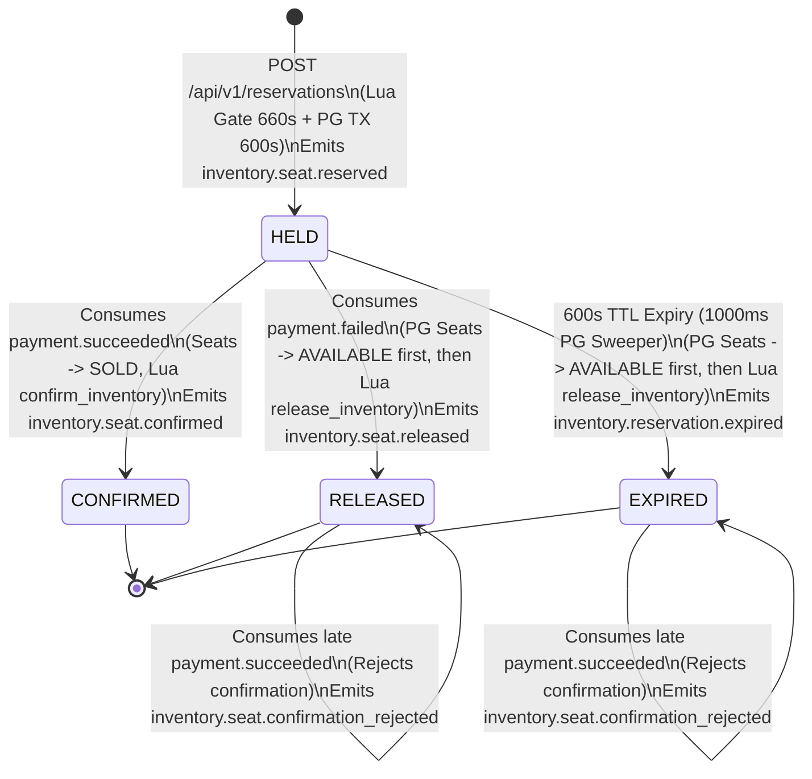
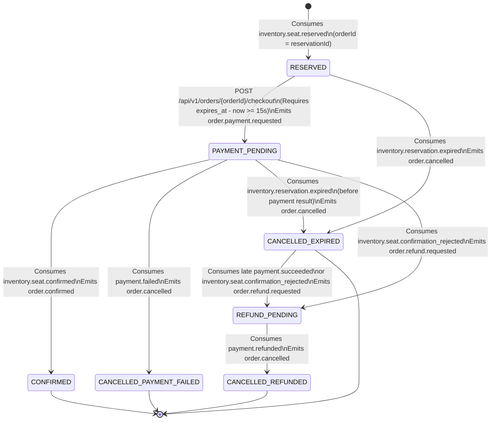

## 2. Order Saga (Choreography)

### 2.1 End-to-End Two-Step Flow (`orderId = reservationId`)

The platform uses a **two-step hold-then-pay choreography saga** partitioned across `inventory-service`, `order-service`, `payment-service`, and `notification-service`. To eliminate cross-service ID lookup round-trips and allow the client to proceed from Step 1 to Step 2 with a single identifier, **`orderId` is strictly equal to `reservationId`** (`order_id = reservation_id`) across all APIs, databases, and Kafka events.

1. **Step 1 — Seat Hold (`POST /api/v1/reservations` on `inventory-service`)**:
   - The client submits `eventId` and `seatIds` (1 to 6 assigned seat UUIDs) with an `Idempotency-Key` header.
   - `inventory-service` generates `reservationId` (UUIDv7) and executes `hold_inventory.lua` in Redis 7. The Lua script atomically checks that the event drop time has passed, verifies none of the `seat:{eventId}:{seatId}` keys exist, sets each `seat:{eventId}:{seatId}` to `reservationId` with a **660-second TTL** (`EX 660`) as a safety net, and returns the plain string `"HELD"`.
   - `inventory-service` opens a local PostgreSQL transaction on `inventory_db`, updates `seats` (`status = 'HELD'`, `version = version + 1`), inserts `reservations` (`reservation_id`, `status = 'HELD'`, `expires_at = created_at + INTERVAL '600 seconds'`), inserts `reservation_items` (`status = 'HELD'`), and inserts an `inventory.seat.reserved` event into `outbox_events`.
   - If the PostgreSQL transaction throws any exception or rolls back, `inventory-service` immediately executes `release_inventory.lua` in a `finally` block to remove the Redis seat lock keys.
   - Upon PostgreSQL commit, `inventory-service` returns `201 Created` with `reservationId` (which is also the `orderId`) and `expiresAt`.
   - Within 200 ms, the `inventory-service` outbox poller publishes `inventory.seat.reserved` to `inventory.events` using `reservationId` as the Kafka partition key.
   - `order-service` consumes `inventory.seat.reserved` and inserts a row into `order_db.orders` with `order_id = reservationId`, `reservation_id = reservationId`, `status = 'RESERVED'`, and `expires_at`.
2. **Step 2 — Order Checkout (`POST /api/v1/orders/{orderId}/checkout` on `order-service`)**:
   - The client calls `POST /api/v1/orders/{orderId}/checkout` (where `orderId` equals `reservationId`) with `paymentMethodToken` and an `Idempotency-Key` header.
   - If the `orders` row for `orderId` has not yet been materialized from `inventory.seat.reserved`, `order-service` immediately returns `409 Conflict` with RFC 7807 error code `ORDER_NOT_READY` and header `Retry-After: 1`.
   - If the order exists in `RESERVED` state and `expires_at - NOW() >= INTERVAL '15 seconds'`, `order-service` updates `orders.status` to `PAYMENT_PENDING`, inserts `order.payment.requested` into `outbox_events`, and returns `202 Accepted`.

---

### 2.2 State Machines

#### `inventory-service` Reservation State Machine (`inventory_db.reservations.status`)

#### `order-service` Order Saga State Machine (`order_db.orders.status`)

---

### 2.3 Exhaustive State Transition Table

#### Table A: `inventory-service` Transitions (`inventory_db.reservations`)

| Current State | Triggering HTTP Call or Kafka Event | Guard Condition | Database Mutation (`inventory_db`) | Post-Commit Redis Action | Outbox Event Emitted (`inventory.events`) | Next State |
| :--- | :--- | :--- | :--- | :--- | :--- | :--- |
| `(None)` | `POST /api/v1/reservations` | Pre-TX `hold_inventory.lua` returned `"HELD"`; `seats.status = 'AVAILABLE'` in PG | Insert `reservations` (`HELD`, `expires_at = now + 600s`), insert `reservation_items` (`HELD`), update `seats` (`status = 'HELD'`, `version + 1`) | Already set in pre-TX Lua (`seat:{eventId}:{seatId}` EX 660); if PG TX fails, run `release_inventory.lua` | `inventory.seat.reserved` | `HELD` |
| `HELD` | `payment.succeeded` | `reservations.status = 'HELD'` (even if `now > expires_at`, as long as expiry sweeper has not committed `EXPIRED`) | Update `reservations` (`CONFIRMED`, `confirmed_at = now`), update `reservation_items` (`CONFIRMED`), update `seats` (`status = 'SOLD'`, `version + 1`) | Execute `confirm_inventory.lua` (sets `seat:{eventId}:{seatId}` to `"SOLD"` with no TTL so `SOLD` keys never expire) | `inventory.seat.confirmed` | `CONFIRMED` |
| `HELD` | `payment.failed` | `reservations.status = 'HELD'` | Update `reservations` (`RELEASED`), update `reservation_items` (`RELEASED`), update `seats` (`status = 'AVAILABLE'`, `version + 1`) | Execute `release_inventory.lua` (deletes `seat:{eventId}:{seatId}` matching `reservationId`) | `inventory.seat.released` | `RELEASED` |
| `HELD` | `1000 ms` PostgreSQL Sweeper | `reservations.status = 'HELD' AND expires_at <= NOW()` | Update `reservations` (`EXPIRED`), update `reservation_items` (`EXPIRED`), update `seats` (`status = 'AVAILABLE'`, `version + 1`) | Execute `release_inventory.lua` **after** PG TX commit (deletes `seat:{eventId}:{seatId}` matching `reservationId`) | `inventory.reservation.expired` | `EXPIRED` |
| `EXPIRED` or `RELEASED` | `payment.succeeded` | `reservations.status IN ('EXPIRED', 'RELEASED')` | No change to `reservations` or `seats`; record `processed_events` | None | `inventory.seat.confirmation_rejected` | `EXPIRED` or `RELEASED` |
| `CONFIRMED` | Expiry sweeper or duplicate `payment.succeeded` | `reservations.status = 'CONFIRMED'` | No-op (idempotent ignore) | None | None | `CONFIRMED` |

#### Table B: `order-service` Transitions (`order_db.orders`)

| Current State | Triggering HTTP Call or Kafka Event | Guard Condition | Database Mutation (`order_db`) | Outbox Event Emitted (`order.events`) | Next State |
| :--- | :--- | :--- | :--- | :--- | :--- |
| `(None)` | `inventory.seat.reserved` | `order_id` does not exist in `orders` | Insert `orders` (`order_id = reservation_id`, `status = 'RESERVED'`, `expires_at`) and `order_items` | None | `RESERVED` |
| `(None)` | `POST /api/v1/orders/{orderId}/checkout` | `order_id` not found in `orders` | None (reject HTTP request with `409 ORDER_NOT_READY` and `Retry-After: 1` header) | None | `(None)` |
| `RESERVED` | `POST /api/v1/orders/{orderId}/checkout` | `expires_at - NOW() >= INTERVAL '15 seconds'` | Update `orders` (`status = 'PAYMENT_PENDING'`, `payment_method_token`, `checkout_at = now`) | `order.payment.requested` | `PAYMENT_PENDING` |
| `RESERVED` | `POST /api/v1/orders/{orderId}/checkout` | `expires_at - NOW() < INTERVAL '15 seconds'` | None (reject HTTP request with `409 RESERVATION_EXPIRED`) | None | `RESERVED` |
| `RESERVED` | `inventory.reservation.expired` | `orders.status = 'RESERVED'` | Update `orders` (`status = 'CANCELLED_EXPIRED'`, `cancelled_at = now`, `cancellation_reason = 'RESERVATION_EXPIRED'`) | `order.cancelled` | `CANCELLED_EXPIRED` |
| `PAYMENT_PENDING` | `payment.succeeded` | `orders.status = 'PAYMENT_PENDING'` | Update `orders` (`payment_id = payload.paymentId`, `paid_at = payload.paidAt`); remain in `PAYMENT_PENDING` awaiting `inventory.seat.confirmed` or `inventory.seat.confirmation_rejected` | None | `PAYMENT_PENDING` |
| `PAYMENT_PENDING` | `inventory.seat.confirmed` | `orders.status = 'PAYMENT_PENDING'` | Update `orders` (`status = 'CONFIRMED'`, `payment_id = COALESCE(payment_id, payload.paymentId)`, `confirmed_at = now`) | `order.confirmed` | `CONFIRMED` |
| `CONFIRMED` | `payment.succeeded` | `orders.status = 'CONFIRMED'` | Backfill `orders` (`payment_id = payload.paymentId`, `paid_at = payload.paidAt`, `updated_at = now`) with no status change | None | `CONFIRMED` |
| `PAYMENT_PENDING` | `payment.failed` | `orders.status = 'PAYMENT_PENDING'` | Update `orders` (`status = 'CANCELLED_PAYMENT_FAILED'`, `cancelled_at = now`, `cancellation_reason = 'PAYMENT_FAILED'`) | `order.cancelled` | `CANCELLED_PAYMENT_FAILED` |
| `PAYMENT_PENDING` | `inventory.reservation.expired` | `orders.status = 'PAYMENT_PENDING'` and `payment_id IS NULL` | Update `orders` (`status = 'CANCELLED_EXPIRED'`, `cancelled_at = now`, `cancellation_reason = 'RESERVATION_EXPIRED'`) | `order.cancelled` | `CANCELLED_EXPIRED` |
| `PAYMENT_PENDING` | `inventory.seat.confirmation_rejected` | `orders.status = 'PAYMENT_PENDING'` | Update `orders` (`status = 'REFUND_PENDING'`, `payment_id = payload.paymentId`, `cancellation_reason = 'LATE_PAYMENT_EXPIRED_HOLD'`) | `order.refund.requested` | `REFUND_PENDING` |
| `CANCELLED_EXPIRED` | `payment.succeeded` OR `inventory.seat.confirmation_rejected` | `orders.status = 'CANCELLED_EXPIRED'` | Update `orders` (`status = 'REFUND_PENDING'`, `payment_id = payload.paymentId`, `cancellation_reason = 'LATE_PAYMENT_EXPIRED_HOLD'`) | `order.refund.requested` | `REFUND_PENDING` |
| `REFUND_PENDING` | `payment.refunded` | `orders.status = 'REFUND_PENDING'` | Update `orders` (`status = 'CANCELLED_REFUNDED'`, `refunded_at = now`) | `order.cancelled` | `CANCELLED_REFUNDED` |
| Any state | Any Kafka event not listed above | `(state, eventType)` pair not matched in this table | Record `event_id` in `processed_events`; no mutation to `orders`; log at `INFO` level and acknowledge Kafka offset immediately (never retried or sent to DLT) | None | Unchanged |

> **Catch-All Rule for Unlisted State/Event Pairs**: Any `(status, eventType)` pair not explicitly listed in Table B is recorded in `processed_events`, logged at `INFO` level with `orderId`, `currentStatus`, and `eventType`, and acknowledged immediately. It is **never** thrown as an exception, never retried on retry topics, and never routed to the dead-letter topic (DLT).

---

### 2.4 Edge Cases, Race Conditions, and Failure Recovery

#### 1. Checkout Before `inventory.seat.reserved` Is Consumed (Early-Checkout Race)
- **Scenario**: The client receives `201 Created` from `POST /api/v1/reservations` on `inventory-service` at `t = 0 ms` and immediately calls `POST /api/v1/orders/{orderId}/checkout` at `t = 15 ms`, before the `inventory-service` 200 ms outbox poller and `order-service` consumer have materialized the `orders` row in `order_db`.
- **Mandatory Resolution**: `order-service` queries `SELECT status, expires_at FROM orders WHERE order_id = :orderId`. When zero rows are returned, `order-service` does **not** return `404 Not Found` and does **not** block threads waiting on Kafka. It returns HTTP `409 Conflict` with header `Retry-After: 1` and RFC 7807 error code `ORDER_NOT_READY`. Because `Idempotency-Key` is only committed for `RESERVED -> PAYMENT_PENDING` transitions (or released on `409 ORDER_NOT_READY`), the client retries `/api/v1/orders/{orderId}/checkout` after 1 second with the same `Idempotency-Key`.

#### 2. Late Payment vs. Reservation TTL Expiry Race (`payment.succeeded` vs. `inventory.reservation.expired`)
- **Scenario**: A user initiates checkout at `t = 580s`. `payment-service` experiences provider latency and completes the charge at `t = 601s`, emitting `payment.succeeded`. Meanwhile, at `t = 600s`, `inventory-service` expired the hold in `inventory_db` (`HELD -> EXPIRED`), released the seat to another buyer, and emitted `inventory.reservation.expired`.
- **Mandatory Resolution**:
  1. **Grace Buffer at Checkout**: `order-service` rejects any `POST /api/v1/orders/{orderId}/checkout` request where `expires_at - NOW() < INTERVAL '15 seconds'` with `409 Conflict` (`RESERVATION_EXPIRED`).
  2. **Authoritative Inventory Check**: `order-service` never transitions directly from `PAYMENT_PENDING` to `CONFIRMED` solely upon receiving `payment.succeeded`. Instead, `inventory-service` consumes `payment.succeeded` and checks `reservations.status` in `inventory_db` under `FOR UPDATE` row lock:
     - If `reservations.status == 'HELD'`, `inventory-service` transitions the reservation to `CONFIRMED`, marks seats `SOLD`, and emits `inventory.seat.confirmed`.
     - If `reservations.status IN ('EXPIRED', 'RELEASED')`, `inventory-service` leaves the reservation untouched and emits `inventory.seat.confirmation_rejected` with `paymentId` and `reason = 'RESERVATION_ALREADY_EXPIRED'`.
  3. **Automatic Refund Compensation**: When `order-service` consumes `inventory.seat.confirmation_rejected` (or consumes `payment.succeeded` after already transitioning to `CANCELLED_EXPIRED`), it transitions the order to `REFUND_PENDING` and emits `order.refund.requested`. `payment-service` consumes `order.refund.requested`, refunds the charge, and emits `payment.refunded`, transitioning the order to `CANCELLED_REFUNDED`. Zero seats are oversold, and zero customers are charged for unfulfilled tickets.

#### 3. Duplicate Kafka Events (At-Least-Once Delivery)
- **Scenario**: An outbox poller crashes after sending a Kafka batch but before committing `UPDATE outbox_events SET published_at = NOW()`, or a Kafka consumer rebalances mid-batch, causing duplicate delivery of `inventory.seat.reserved`, `order.payment.requested`, or `payment.succeeded`.
- **Mandatory Resolution**:
  - Every stateful consumer (`inventory-service`, `order-service`, `payment-service`) executes `INSERT INTO processed_events (event_id, consumer_group, processed_at) VALUES (:eventId, :groupId, NOW()) ON CONFLICT (event_id, consumer_group) DO NOTHING` inside the same local PostgreSQL transaction as its domain table updates. If `0` rows are inserted, the consumer logs at `DEBUG` level and acknowledges the offset immediately without mutating state.
  - Even if two different `eventId` instances represent the same logical transition (for example, multiple `inventory-service` instances running the `1000 ms` PostgreSQL sweeper or a sweeper racing with `payment.succeeded`), `FOR UPDATE SKIP LOCKED` and the `FOR UPDATE` row lock on `reservations` check `WHERE status = 'HELD'`, so only the first transaction succeeds and emits `inventory.reservation.expired`.

#### 4. Service Crashing Mid-Saga
- **Crash in `inventory-service` after Redis `hold_inventory.lua` succeeds but before PostgreSQL commit**:
  - The PostgreSQL transaction never commits, so no `reservations` row exists in `inventory_db` and no `inventory.seat.reserved` event is emitted. In the rare case the JVM is `SIGKILL`-ed before the `finally` block can invoke `release_inventory.lua`, the Redis key `seat:{eventId}:{seatId}` automatically expires after its 660-second safety-net TTL, self-healing the seat lock.
- **Crash in `inventory-service`, `order-service`, or `payment-service` after PostgreSQL commit but before Outbox Poller publishes to Kafka**:
  - Because `outbox_events` was committed atomically in the same local PostgreSQL transaction as the domain state change (`published_at IS NULL`), PostgreSQL releases the crashed leader's session-level advisory lock (`pg_try_advisory_lock`) when its connection closes, and the next 200 ms poll cycle on the newly elected poller instance picks up the row and publishes it to Kafka.
- **Crash in `payment-service` during external mock provider execution**:
  - When `order.payment.requested` is redelivered after consumer rebalance or retry backoff, `payment-service` checks `payments` by `UNIQUE (order_id)`. If a row already exists in `SUCCEEDED` or `FAILED` status, it does not double-charge.

