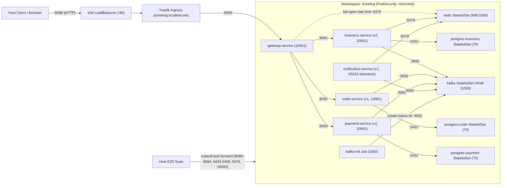

# Kubernetes Deployment Guide (k3d + Kustomize)

Local Kubernetes deployment of the Flash-Sale Ticketing Platform on a 3-node `k3d` cluster (`1` server + `2` agents) managed with Kustomize (`deploy/k8s/base` and `deploy/k8s/overlays/local`).

---

## 1. Architecture



---

## 2. Prerequisites & How to Run

### Prerequisites
- Docker Desktop / Docker Engine running (`>= 8 GiB` VM RAM recommended).
- `k3d` (`brew install k3d`) and `kubectl` (`brew install kubectl`).
- `infra/.env` present (copied from `infra/.env.example` if needed; never committed).
- Stop the Docker Compose stack before creating the cluster (`make stack-down && make obs-down`) so host ports `8080..8084`, `5433..5435`, `6379`, `29092`, `9090`, and `3000` are free.

### Commands

```bash
# 1. Render and validate base + local overlay (kubeconform strict + kube-linter via Docker)
make k8s-lint

# 2. Create k3d cluster (idempotent), build/tag/import images, create Secret, deploy local overlay, wait <=6m
make k8s-up

# 3. Inspect nodes, pods, services, ingress, and resource usage (kubectl top)
make k8s-status

# 4. Forward all 10 service/infra ports to localhost (matches Docker Compose host ports)
make k8s-forward

# 5. Run the unchanged fast end-to-end suite against the cluster
make e2e-fast

# 6. Stop background port-forwards cleanly
make k8s-forward-stop

# 7. Tail logs or rebuild & roll out a single service
make k8s-logs SERVICE=inventory-service
make k8s-redeploy SERVICE=inventory-service

# 8. Reset namespace (deletes all pods, PVCs, Secrets, Jobs; keeps k3d cluster and cached images)
make k8s-down

# 9. Destroy the k3d cluster completely
make k8s-destroy
```

### Environment Variables
- `K3S_IMAGE`: Pinned k3s node image (default `rancher/k3s:v1.35.5-k3s1`).
- `K8S_SKIP_BUILD=1`: Skip `make stack-build` / `k3d image import` during `make k8s-up` when images are already imported into the cluster.
- `K8S_UP_TIMEOUT_SEC`: Readiness wait limit for `make k8s-up` (default `360`).
- `K8S_SCHEMA_VERSION`: Kubernetes JSON schema version passed to `kubeconform` (default `1.35.0`).

---

## 3. Port Map

| Component | In-Cluster Service DNS & Port | Host Port (`k8s-forward` / Ingress) | Notes |
| :--- | :--- | :--- | :--- |
| **Ingress (Gateway)** | `gateway-ingress` (`ticketing.localtest.me`) | `http://ticketing.localtest.me:8088` | k3d maps host `8088` -> Traefik LB `80` -> `gateway-service:8080` |
| **`gateway-service`** | `gateway-service.ticketing.svc.cluster.local:8080` | `127.0.0.1:8080` | Management port `8085` (prod base) is **never** exposed on the Service |
| **`inventory-service`** | `inventory-service.ticketing.svc.cluster.local:8081` | `127.0.0.1:8081` | Spring Boot WebMVC + Actuator |
| **`order-service`** | `order-service.ticketing.svc.cluster.local:8082` | `127.0.0.1:8082` | Spring Boot WebMVC + Actuator |
| **`payment-service`** | `payment-service.ticketing.svc.cluster.local:8083` | `127.0.0.1:8083` | Spring Boot WebMVC + Actuator |
| **`notification-service`** | `notification-service.ticketing.svc.cluster.local:8084` | `127.0.0.1:8084` | Go worker (`/health`, `/ready`, `/metrics`) |
| **`postgres-inventory`** | `postgres-inventory.ticketing.svc.cluster.local:5432` | `127.0.0.1:5433` | Database `inventory_db` |
| **`postgres-order`** | `postgres-order.ticketing.svc.cluster.local:5432` | `127.0.0.1:5434` | Database `order_db` |
| **`postgres-payment`** | `postgres-payment.ticketing.svc.cluster.local:5432` | `127.0.0.1:5435` | Database `payment_db` |
| **`redis`** | `redis.ticketing.svc.cluster.local:6379` | `127.0.0.1:6379` | Append-only (`--appendonly yes`), no keyspace notifications |
| **`kafka`** | `kafka.ticketing.svc.cluster.local:9092` (internal)<br>`kafka.ticketing.svc.cluster.local:29092` (external) | `127.0.0.1:29092` | Dual listener (see Section 8) |

---

## 4. Base vs Local Overlay

| Aspect | `deploy/k8s/base` (Production-Like) | `deploy/k8s/overlays/local` (Laptop / k3d) |
| :--- | :--- | :--- |
| **Application Replicas** | `gateway`: 2, `inventory`: 2, `order`: 2, `payment`: 2, `notification`: 1 | `gateway`: 1, `inventory`: 2, `order`: 1, `payment`: 2, `notification`: 1 (`inventory` & `payment` stay at 2 to exercise outbox leader election and Kafka consumer groups) |
| **Gateway Spring Profile** | `SPRING_PROFILES_ACTIVE=prod` (disables `/api/v1/auth/token`, binds Actuator to internal port `8085`) | `SPRING_PROFILES_ACTIVE=local` + `gateway-local-config` ConfigMap (`TICKETING_GATEWAY_ALLOW_INSECURE_DEV_SECRET=true`, `TICKETING_GATEWAY_DEV_TOKEN_ENABLED=true`, `TICKETING_GATEWAY_DEV_TOKEN_ALLOW_ADMIN=true`) so the unchanged E2E suite can request dev tokens |
| **Gateway Probes & Scrape Port** | `startupProbe`, `livenessProbe`, `readinessProbe`, and `prometheus.io/port` target named port `management` (`8085`) | Patched to main port `http` (`8080`) because `application-local.yml` serves Actuator on `8080` |
| **Image Tag & Pull Policy** | Controlled in one place via Kustomize `images` transformer | Tag `dev` (imported via `k3d image import` alongside `:<short-git-sha>`); `imagePullPolicy: IfNotPresent` patched onto all Deployments |
| **Kafka Topic Init** | `configMapGenerator` reads `infra/kafka/create-topics.sh` directly (not copied) | Inherited from base |

---

## 5. Security Posture

The `ticketing` namespace enforces **`pod-security.kubernetes.io/enforce=restricted`** (plus `audit=restricted`, `warn=restricted`). Every application pod, infrastructure StatefulSet, initContainer, and Job complies with `restricted` — **zero baseline downgrades were needed**.

| Workload | Image | ServiceAccount (`automount=false`) | UID : GID : fsGroup | `runAsNonRoot` | `readOnlyRootFilesystem` | Writable Volumes | `allowPrivilegeEscalation` / Caps / Seccomp |
| :--- | :--- | :--- | :--- | :---: | :---: | :--- | :--- |
| `gateway-service` | `ticketing/gateway-service:dev` (Alpine JRE 21) | `gateway-service` | `10001:10001:10001` | `true` | `true` | `/tmp` (`emptyDir`) | `false` / `drop: [ALL]` / `RuntimeDefault` |
| `inventory-service` | `ticketing/inventory-service:dev` (Alpine JRE 21) | `inventory-service` | `10001:10001:10001` | `true` | `true` | `/tmp` (`emptyDir`) | `false` / `drop: [ALL]` / `RuntimeDefault` |
| `order-service` | `ticketing/order-service:dev` (Alpine JRE 21) | `order-service` | `10001:10001:10001` | `true` | `true` | `/tmp` (`emptyDir`) | `false` / `drop: [ALL]` / `RuntimeDefault` |
| `payment-service` | `ticketing/payment-service:dev` (Alpine JRE 21) | `payment-service` | `10001:10001:10001` | `true` | `true` | `/tmp` (`emptyDir`) | `false` / `drop: [ALL]` / `RuntimeDefault` |
| `notification-service` | `ticketing/notification-service:dev` (Distroless static) | `notification-service` | `65532:65532:65532` | `true` | `true` | `/tmp` (`emptyDir`), `/opt/kafka/logs` (`emptyDir` for `wait-for-order-topic` initContainer) | `false` / `drop: [ALL]` / `RuntimeDefault` |
| `kafka` | `apache/kafka:3.8.0` | `kafka` | `1000:1000:1000` | `true` | `true` | `/var/lib/kafka/data` (PVC), `/opt/kafka/config`, `/opt/kafka/logs`, `/tmp` (`emptyDir`) | `false` / `drop: [ALL]` / `RuntimeDefault` |
| `kafka-init` | `apache/kafka:3.8.0` | `kafka-init` | `1000:1000:1000` | `true` | `true` | `/opt/kafka/logs`, `/tmp` (`emptyDir`) | `false` / `drop: [ALL]` / `RuntimeDefault` |
| `postgres-{inventory,order,payment}` | `postgres:16.4-alpine` | `postgres-*` | `70:70:70` | `true` | `true` | `/var/lib/postgresql/data` (PVC, `PGDATA=.../pgdata`), `/var/run/postgresql`, `/tmp` (`emptyDir`) | `false` / `drop: [ALL]` / `RuntimeDefault` |
| `redis` | `redis:7.4.1-alpine` | `redis` | `999:1000:1000` | `true` | `true` | `/data` (PVC), `/tmp` (`emptyDir`) | `false` / `drop: [ALL]` / `RuntimeDefault` |
| `wait-for-deps` initContainers | `busybox:1.36.1` | Inherited from pod | Inherited (`10001` / `65532`) | `true` | `true` | None needed | `false` / `drop: [ALL]` / `RuntimeDefault` |

---

## 6. Probe Design & Startup Dependency Ordering

### Probe Configuration

All Java services use Spring Boot's dedicated Kubernetes probe groups — **never** the aggregate `/actuator/health` endpoint:

| Service | Startup Probe (`failureThreshold=30, period=5s`) | Liveness Probe | Readiness Probe | Rationale |
| :--- | :--- | :--- | :--- | :--- |
| `gateway-service` | `HTTP GET /actuator/health/readiness` (`management:8085` base / `http:8080` local) | `HTTP GET /actuator/health/liveness` (`livenessState`) | `HTTP GET /actuator/health/readiness` (`readinessState`) | Excludes Redis (rate limiting fails open) and downstream HTTP reachability so a Redis blip never evicts gateway pods. |
| `inventory-service` | `HTTP GET /actuator/health/readiness` (`:8081`) | `HTTP GET /actuator/health/liveness` (`livenessState`) | `HTTP GET /actuator/health/readiness` (`readinessState,db,redis`) | Fails closed on Redis or PostgreSQL outage (seat hold gate requires both); Kafka excluded because the transactional outbox buffers events. |
| `order-service` | `HTTP GET /actuator/health/readiness` (`:8082`) | `HTTP GET /actuator/health/liveness` (`livenessState`) | `HTTP GET /actuator/health/readiness` (`readinessState,db`) | Fails closed on PostgreSQL outage; Kafka excluded due to transactional outbox. |
| `payment-service` | `HTTP GET /actuator/health/readiness` (`:8083`) | `HTTP GET /actuator/health/liveness` (`livenessState`) | `HTTP GET /actuator/health/readiness` (`readinessState,db`) | Fails closed on PostgreSQL outage; Kafka excluded due to transactional outbox. |
| `notification-service` | `HTTP GET /ready` (`:8084`) | `HTTP GET /health` | `HTTP GET /ready` (Kafka TCP + Redis `PING`) | Implemented directly in the Go service (`internal/health/health.go`). |
| `kafka` | `TCP :9092` | `TCP :9092` | `TCP :9092` | Kafka only opens the `:9092` acceptor after KRaft recovery and broker unfencing complete. Using `tcpSocket` avoids the chicken-and-egg deadlock where `kafka-topics.sh` resolves `kafka.ticketing.svc.cluster.local:9092` before the pod enters Service endpoints. |
| `postgres-*` | — | `pg_isready -h 127.0.0.1 -U "$POSTGRES_USER" -d <db>` | `pg_isready -h 127.0.0.1 -U "$POSTGRES_USER" -d <db>` | Native PostgreSQL readiness verification. |
| `redis` | — | `redis-cli ping` | `redis-cli ping` | Native Redis readiness verification. |

### Startup Dependency Ordering (InitContainers)
- Every dependency-bound application (`inventory-service`, `order-service`, `payment-service`, `notification-service`) uses a lightweight `busybox:1.36.1` `wait-for-deps` initContainer with a **180-second bounded wait** per dependency (`postgres-*`, `redis`, `kafka`) that logs the exact missing dependency on timeout. This prevents application `CrashLoopBackOff` restarts when infrastructure starts concurrently.
- `notification-service` additionally runs a `wait-for-order-topic` initContainer (`apache/kafka:3.8.0`, UID/GID `1000`, `readOnlyRootFilesystem: true`, 180-second timeout) calling `kafka-topics.sh --describe --topic order.events`. Because `KAFKA_AUTO_CREATE_TOPICS_ENABLE=false` and `segmentio/kafka-go` subscribes immediately on startup, starting before `kafka-init` creates `order.events` leaves `notification-service-order-cg` stalled with unread lag; waiting for topic existence prevents this race.
- `gateway-service` intentionally has **no blocking Redis or downstream initContainer** so gateway pods can start or recycle cleanly even during a Redis outage (matching its fail-open readiness semantics).
- `kafka-init` uses a `wait-for-kafka` initContainer (`apache/kafka:3.8.0`, 180-second timeout) calling `kafka-topics.sh --list` before executing `create-topics.sh`.

---

## 7. Secrets Flow

- **No secret value is ever committed to Git** (no `Secret` YAML exists under `deploy/k8s/`).
- At deploy time, `scripts/k8s-secrets.sh` reads `POSTGRES_USER`, `POSTGRES_PASSWORD`, and `JWT_SECRET` from `infra/.env` (failing with a clear error if `infra/.env` or any required key is missing), streams a manifest via `kubectl create secret generic ticketing-secrets --namespace ticketing --from-literal=... --dry-run=client -o yaml | kubectl apply -f -`, and never writes secret values to disk or prints them to stdout/stderr.
- Workloads consume credentials exclusively through `env[].valueFrom.secretKeyRef`.

---

## 8. Kafka Dual-Listener Trade-Off

`kafka` runs in single-broker KRaft mode with two client listeners:
- `INTERNAL://:9092` advertised as `kafka.ticketing.svc.cluster.local:9092` (used by in-cluster services and `kafka-init`).
- `EXTERNAL://:29092` advertised as `localhost:29092` (used by host-side clients such as `e2e-tests`'s `KafkaProbe` over `kubectl -n ticketing port-forward svc/kafka 29092:29092`).

**Trade-offs**:
1. Works seamlessly for host-local development/E2E tools via `kubectl port-forward` without NodePort or LoadBalancer TCP routing.
2. Only works for a **single broker** (multi-broker clusters require unique advertised addresses per broker, such as separate per-broker NodePorts/LoadBalancers or SNI routing via Strimzi).
3. `localhost:29092` is only reachable from the machine running `kubectl port-forward` and uses plaintext (no TLS or SASL).

---

## 9. Observability, Linting & Assumptions

- **In-cluster Prometheus is out of scope** for this step; all 5 application pods carry `prometheus.io/scrape: "true"`, `prometheus.io/path`, and `prometheus.io/port` annotations (`8085` on `gateway-service` in base `prod`, patched to `8080` in `local`) ready for future Prometheus scraping.
- **No HPA is configured** (`make k8s-status` notes this explicitly); scaling is fixed via Kustomize `replicas`.
- **`kubectl kustomize --load-restrictor=LoadRestrictionsNone`** is used by `scripts/k8s-lint.sh`, `scripts/k8s-up.sh`, and `scripts/k8s-cluster.sh` so `deploy/k8s/base/kustomization.yaml` can generate the `kafka-init-script` ConfigMap directly from `infra/kafka/create-topics.sh` without duplicating the script.
- **`deploy/k8s/.kube-linter.yaml`** enables all default checks plus `run-as-non-root`, `no-read-only-root-fs`, `unset-cpu-requirements`, `unset-memory-requirements`, `latest-tag`, and `privilege-escalation-container`, with only two documented exclusions (`minimum-three-replicas` and `no-anti-affinity`).
- **Docker VM Memory**: On a `7.75 GiB` (`7,937 MiB`) Docker VM, the sum of local overlay main-container memory limits is `6,400 MiB` (`80.6%`, triggering the `> 75%` warning in `scripts/k8s-cluster.sh`), while actual measured idle usage across all 12 running pods in `ticketing` is **`~2,122 MiB`** (`~3,787 MiB` across all 3 k3d nodes including Kubernetes control plane and Traefik).

---

## 10. Production Gaps (Honest Limits)

This k3d deployment is production-like in container security and probe design, **not** production-ready as-is:
1. **Single Kafka broker (KRaft, RF=1, `min.insync.replicas=1`)**: No fault tolerance or partition replication; production requires a >=3-broker cluster (e.g., Strimzi or managed Kafka) with RF=3 and `min.insync.replicas=2`.
2. **Single PostgreSQL instance per service**: No streaming replication, automatic failover, or automated backups/PITR; production requires managed PostgreSQL or an HA operator (e.g., CloudNativePG).
3. **Single Redis instance**: No Sentinel or Cluster HA; Redis restart briefly makes `inventory-service` NotReady (fail-closed) and `gateway-service` rate-limiting fail-open.
4. **No TLS / mTLS**: All pod-to-pod traffic (HTTP, JDBC, Redis, Kafka) and Traefik Ingress traffic use plaintext; production requires cert-manager TLS termination at Ingress and mTLS/TLS for internal services and data stores.
5. **No external secret manager**: Secrets are pushed from `infra/.env` via `kubectl`; production requires External Secrets Operator / Vault / cloud KMS with rotation.
6. **No in-cluster Prometheus, Alertmanager, or log aggregation**: Pod scrape annotations are present, but in-cluster observability stack deployment is out of scope here.
7. **Local-path storage (`local-path` StorageClass)**: PVCs are pinned to individual k3d nodes with no cross-node replication or snapshots.
8. **No HPA, PodDisruptionBudgets, or NetworkPolicies yet**: k3s's default network policy controller is enabled (`--disable-network-policy=false`), ready for NetworkPolicy manifests in a follow-up hardening step.

---

## 11. Kubernetes End-to-End Test Suite (E2E Mode)

The platform E2E harness (`e2e-tests`) supports execution against both Docker Compose (default) and Kubernetes via the `PlatformBackend` abstraction (`ComposeBackend` vs `K8sBackend`), toggled via `E2E_BACKEND=compose|k8s`.

### Running E2E on Kubernetes
```bash
# 1. Run fast functional scenarios against k3d
make e2e-k8s-fast

# 2. Run chaos and fault-injection scenarios against k3d
make e2e-k8s-chaos

# 3. Full workflow: fast suite -> cluster reset -> chaos suite
make e2e-k8s
```

### K8sBackend Architecture & Mechanics
- **Workload Mapping & Dynamic Discovery**: `gateway-service`, `inventory-service`, `order-service`, `payment-service`, and `notification-service` are managed as `Deployments`; `kafka`, `redis`, and `postgres-*` are managed as `StatefulSets`. Workload kind and label selectors (`spec.selector.matchLabels`) are dynamically queried from the cluster (`kubectl get deployment,statefulset`) rather than hardcoding static labels.
- **Hard Crash (`kill`)**: Forcefully deletes all pods matching the workload selector (`kubectl delete pod -l <selector> --grace-period=0 --force`). This simulates an abrupt SIGKILL while the Kubernetes controller automatically creates replacement pods.
- **Service Stop (`stop`)**: Remembers desired replicas in memory and persists them to `e2e-tests/target/k8s-replicas.json` (preventing overwrite on repeated stops), scales the workload to `0` (`kubectl scale <kind> <name> --replicas=0`), and awaits full pod termination.
- **Service Start (`start`)**: Restores the remembered replica count (or manifest default), scales back up, and waits until the workload is fully ready.
- **Pause / Unpause Semantics**: Kubernetes does not expose a native pause primitive without direct cgroup freezer access. `pause` is intentionally implemented as `stop` (scale to 0) and `unpause` as `start` (scale to desired replicas). This maintains semantic equivalence for test scenarios where the consumer must be absent while events are produced.
- **Readiness Verification (`waitUntilHealthy`)**: Verifies rollout completion (`kubectl rollout status`), verifies Kafka consumer group stability (`ConsumerGroupState.STABLE` with active members via `KafkaProbe`), and for infrastructure restarts (`kafka`, `redis`, `postgres-*`), awaits local TCP port reachability on the supervised `k8s-forward` tunnels.
- **Failover Budget Trade-Off (`180s`)**: `E2E_FAILOVER_BUDGET_SECONDS` defaults to `60s` on Compose and is configured to `180s` for Kubernetes in `Makefile`. A pod failover on Kubernetes entails container scheduling, initContainer dependency checks (`wait-for-deps`), JVM cold start, Spring Boot readiness probe intervals (`failureThreshold=30, period=5s`), and Kafka consumer group rejoining. As a result, recovery numbers on Kubernetes are not directly comparable to Docker Compose container restarts.

---

## 12. Known Issues

- **Transient `/actuator/health` 503 on `gateway-service` immediately after cold boot**: Because `gateway-service` has no blocking Redis initContainer (deliberate fail-open design), its aggregate `/actuator/health` endpoint (checked by `PreflightExtension.beforeAll`) may briefly report `503 DOWN` for a few seconds right after `make k8s-up` if Lettuce's initial Redis connection check runs while `redis-0` is finishing boot, even though `/actuator/health/readiness` is `200 UP`. Waiting a few seconds resolves it cleanly.
- **Initial cold boot time**: On a brand-new cluster without cached infra images, `make k8s-up` imports local images and initializes Kafka KRaft + 15 topics + Flyway migrations across 3 databases, taking ~3–6 minutes depending on host CPU load. Subsequent resets (`make k8s-down && K8S_SKIP_BUILD=1 make k8s-up`) are faster because k3d retains imported images.
- **Docker VM limit overcommit warning on 8 GiB laptops**: The sum of local overlay container memory limits (`6,400 MiB`) exceeds `75%` of a `7,937 MiB` Docker VM, producing a preflight warning in `scripts/k8s-cluster.sh`. Actual measured idle usage is ~`2.1 GiB` for the `ticketing` namespace (~`3.8 GiB` total across all 3 k3d nodes).
